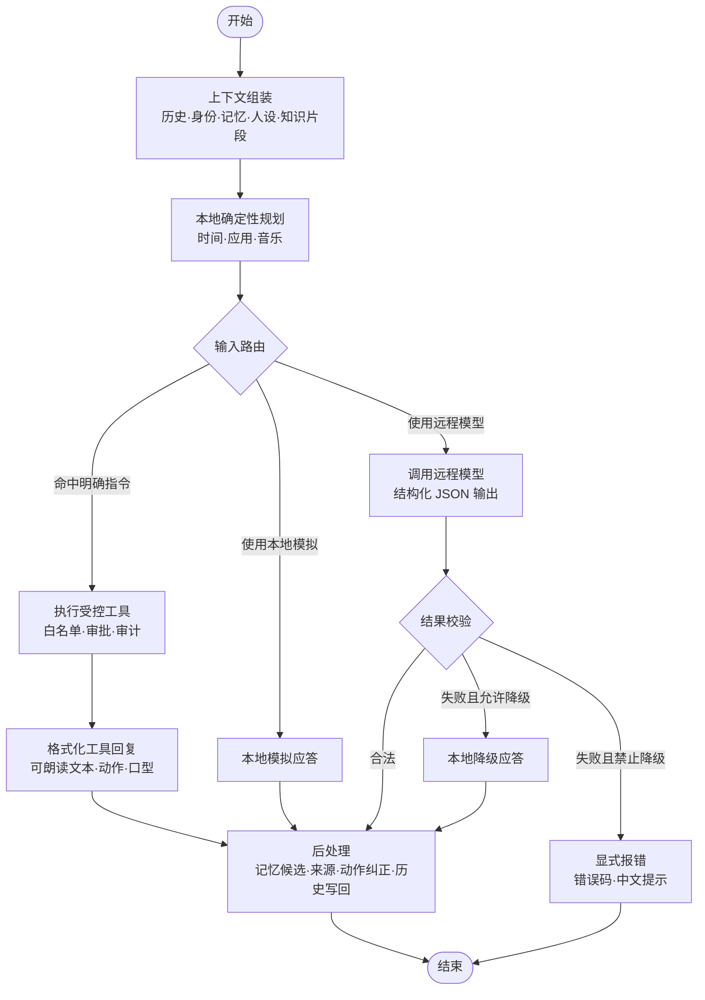

# LangGraph 工作流渐进式迭代方案

> 文档定位：在不推翻现有 FastAPI 网关、Vue 前端、Godot 渲染和云端能力接入方式的前提下，将当前自研的隐式编排管线逐步收敛为可观测、可恢复、可人工介入的 LangGraph 工作流。
>
> 迁移原则：**先包裹、再抽取；先等价、后增强；默认灰度、随时回滚。**
>
> 创建日期：2026-11-02

---

## 一、结论先行

当前项目已经具备完整的“感知 → 上下文组装 → 决策 → 工具安全执行 → 动作反馈”链路，但这条链路主要集中在 `backend/app/agent.py` 的 `AgentService.respond()` 中，由顺序代码和条件分支隐式表达。它不是缺少能力，而是缺少统一的工作流运行时。

本次不做全量重写，建议保留现有 `AgentService.respond()` 作为稳定入口，在其内部增加可切换的工作流引擎：

1. 第一阶段只做“等价搬运”，把现有逻辑拆成上下文组装、本地规划、受控工具、远程模型、兜底响应、后处理等节点；
2. 第二阶段利用 LangGraph 的条件边、状态契约、检查点和事件流，获得节点级可观测与重启恢复；
3. 第三阶段再把 `open_file` 等需要人工确认的流程升级为 LangGraph `interrupt()` 挂起与恢复；
4. 整个过程中保持 HTTP / WebSocket 接口、前端 `AgentClient` 和 Godot 事件协议基本不变。

---

## 二、源码通读范围

本次重点阅读以下代码与文档：

| 范围 | 关键文件 | 阅读目的 |
|---|---|---|
| 后端智能体主编排 | `backend/app/agent.py` | 确认当前会话、身份、记忆、人设、RAG、工具和降级的真实执行顺序 |
| 后端网关入口 | `backend/app/main.py` | 确认 REST、WebSocket、异常映射和桌宠事件广播方式 |
| 受控工具 | `backend/app/controlled_tools.py` | 确认白名单、审批、审计、工具风险等级和实际执行边界 |
| 语音工具规划 | `backend/app/voice_tool_planner.py` | 确认确定性正则规划规则 |
| Agent 事件协议 | `backend/app/agent_events.py` | 确认 WebSocket 请求和事件模型 |
| 前端主界面 | `src/App.vue` | 确认连续语音、ASR 后提交、TTS 播报、动作切换和本地快速通道 |
| 前端 Agent 客户端 | `src/agent/AgentClient.ts` | 确认前端 HTTP / WebSocket 兼容路径 |
| 桌宠事件 | `backend/app/pet_events.py`、`docs/桌宠事件协议.md` | 确认动作和口型事件协议 |
| Godot 与 Tauri | `godot/pet_client`、`src-tauri/src/lib.rs` | 确认渲染层和桌面进程边界 |
| 已有设计资料 | `docs/langgraph工作流-纯文字版.md`、`docs/面试项目说明-桌宠智能体.md` | 对齐已有架构描述和迁移蓝图 |

基线测试结果：

```powershell
python -m pytest backend/tests -q
```

当前结果为 **178 个后端测试全部通过**。这是迁移前的重要回归基线。

---

## 三、当前自研工作流的实际链路

### 3.1 文字请求链路

1. 前端调用 `POST /api/agent/chat`，或通过 `WS /api/agent/events` 发送 `agent.message`；
2. `AgentService.respond()` 读取当前会话的短期历史；
3. 获取身份快照，判断是否可以读取私有记忆和使用受控工具；
4. 如果身份允许，读取已确认长期记忆；
5. 读取当前激活的人设；
6. 如果请求指定 RAG 集合，则检索最多 3 个知识片段；
7. 根据 `AGENT_PROVIDER` 选择：
   - `mock`：本地确定性模拟回复；
   - `qwen` 或 `openai-compatible`：调用远程 OpenAI 兼容接口；
   - 其他值：按配置报错或降级；
8. 将 RAG 来源和状态附加到响应；
9. 将远程模型或本地模拟回复提出的记忆建议写入候选表；
10. 把身份状态写回响应；
11. 将本轮问答追加到短期会话内存；
12. 网关广播 `pet.action`，Godot 或前端执行动作和口型变化。

### 3.2 语音请求链路

完整业务链路如下：

麦克风采集 → 本地唤醒词和人声检测 → 豆包流式 ASR → 识别为文本 → 本地快速判断 → Agent 回复 → MiniMax TTS → 口型与动作同步。

后端在 `source="voice"` 时还会执行一套语音专用确定性规划：

- “现在几点 / 今天日期” → `get_time`；
- “打开某某应用”且应用名位于白名单 → `open_application`；
- “播放 / 暂停音乐”且命中音乐上下文 → `control_music`。

需要特别注意：当前前端 `src/App.vue` 中还存在一条单独的“本地时间工具快速通道”。ASR 识别完成后，`submitRecognizedVoiceCommand()` 会先调用 `handleLocalVoiceTool()`；未命中后再调用 `submitAgentMessage()`，且当前提交给 Agent 的来源是 `text`。这意味着真实前端运行时，后端 `source="voice"` 的规划路径不一定会被触发，容易形成前后端双轨判断。

---

## 四、当前实现的主要优化点

| 问题 | 具体表现 | 影响 |
|---|---|---|
| 编排逻辑集中 | `AgentService.respond()` 同时承担上下文、路由、工具、降级、后处理和历史写入 | 方法较长，分支先后顺序不够直观 |
| 路由规则分散 | 前端有时间快速通道，后端有语音工具规划器 | 规则可能重复，后续新增指令时容易漏改 |
| 语音来源语义不一致 | 前端 ASR 后实际常以 `source="text"` 提交 | 后端语音工具规划能力和真实界面链路存在偏差 |
| 工作流状态不显式 | 历史、身份、记忆、RAG、工具结果和错误只存在于方法执行过程中 | 难以回放、调试和追踪节点耗时 |
| 人工审批不是流程状态 | 当前审批单通过数据库和独立接口表达 | 网关重启后，“图执行到了哪里”缺少统一运行时语义 |
| 短期历史依赖内存 | `ConversationMemory` 使用进程内有序字典 | 网关重启后短期上下文丢失 |
| 节点级测试成本较高 | 测试一个分支往往需要构造完整 `AgentService` | 后续扩展复杂指令时测试粒度偏粗 |
| 同步工具有阻塞事件循环风险 | `ControlledToolService.execute()` 是同步方法 | 当前负载较低问题不明显，迁移时应改为线程执行并保留锁 |

---

## 五、引入 LangGraph 的目标与非目标

### 5.1 目标

1. 将隐式顺序代码变成显式状态机；
2. 用统一 State 描述一次会话回合内的数据；
3. 用条件边明确工具、远程模型、降级和报错路径；
4. 保持现有安全边界：模型只能生成结构化回复，不能直接执行桌面操作；
5. 支持节点级事件流和调试追踪；
6. 支持检查点，使网关重启后可以恢复短期执行状态；
7. 后续用 `interrupt()` 原生表达工具审批；
8. 为未来并行检索、多阶段规划和多 Agent 协作预留扩展点。

### 5.2 非目标

1. 不在第一阶段重写 Vue、Tauri、Godot；
2. 不替换豆包 ASR、MiniMax TTS、Qwen 或 RAG 服务；
3. 不把模型工具调用直接升级为任意桌面执行权限；
4. 不在第一阶段引入多智能体互跳；
5. 不改变现有接口的核心响应结构；
6. 不把完整聊天记录、RAG 文档或密钥复制到新的检查点中。

---

## 六、目标工作流

### 6.1 中文流程图



### 6.2 现有逻辑到图节点的映射

| 当前代码逻辑 | LangGraph 节点 | 说明 |
|---|---|---|
| `ConversationMemory.history()` | 上下文组装 | 读取有界短期历史 |
| `IdentityService.snapshot()` | 上下文组装 | 获取身份与权限快照 |
| `MemoryStore.context()` | 上下文组装 | 仅主人可读取已确认记忆 |
| `PersonaStore.get_active()` | 上下文组装 | 获取当前激活人设 |
| `AgentService._retrieve_references()` | 上下文组装 | 检索 RAG，并记录不可用状态 |
| `plan_voice_tool()` | 本地确定性规划 | 不调用模型，只做明确指令识别 |
| `ControlledToolService.execute()` | 执行受控工具 | 保留白名单、所有者校验、审批和审计 |
| `AgentService._voice_tool_response()` | 格式化工具回复 | 将工具结果转成可朗读响应 |
| `OpenAiCompatibleAgent.respond()` | 调用远程模型 | 保持现有提示词和 JSON Schema |
| `MockAgent.respond()` | 本地模拟应答 / 本地降级应答 | 同一实现，语义按入口区分 |
| `AgentService._fallback_or_raise()` | 结果校验条件边 | 根据配置选择降级或报错 |
| 记忆候选、RAG 元数据、动作纠正、历史追加 | 后处理 | 所有成功路径统一汇合 |

---

## 七、状态契约设计

建议新增 `backend/app/agent_workflow/state.py`，使用 `TypedDict` 定义图状态。字段名作为代码标识符保留英文，字段含义和流转说明全部使用中文。

| 状态字段 | 类型建议 | 含义 | 主要写入节点 |
|---|---|---|---|
| `request` | `AgentRequest` | 本轮用户请求 | 图输入 |
| `history` | `Sequence[ConversationMessage]` | 短期会话历史 | 上下文组装 |
| `identity` | `IdentitySnapshot` | 当前身份和权限快照 | 上下文组装 |
| `memories` | `Sequence[MemoryRecord]` | 已确认长期记忆 | 上下文组装 |
| `persona` | `PersonaProfile | None` | 当前激活人设 | 上下文组装 |
| `sources` | `list[AgentSource]` | 面向前端展示的引用来源 | 上下文组装 / 后处理 |
| `references` | `Sequence[RagSearchHit]` | 提供给模型的 RAG 内容 | 上下文组装 |
| `rag_status` | `disabled / used / empty / unavailable` | RAG 检索状态 | 上下文组装 |
| `tool_plan` | `ToolExecuteRequest | None` | 本地规划出的工具请求 | 本地确定性规划 |
| `tool_result` | `ToolCallResult | None` | 工具执行结果 | 执行受控工具 |
| `response` | `AgentResponse | None` | 结构化回复 | 工具、模拟、远程模型节点 |
| `error` | `AgentErrorState | None` | 可预期错误码、提示和降级信息 | 远程模型或异常处理 |

状态契约注意事项：

1. 不要把 `Settings`、API Key、数据库连接或服务实例放进可持久化状态；
2. State 中只保存业务数据，服务依赖通过节点闭包或运行时依赖注入；
3. RAG 内容仍按“不可信资料”处理；
4. 检查点中可能出现用户消息和记忆内容，因此检查点数据库必须放在本地数据目录；
5. 错误状态应包含错误码、中文提示和 HTTP 状态码，避免节点内直接抛出不可追踪的裸异常。

---

## 八、建议目录结构

```text
backend/app/agent_workflow/
├── __init__.py
├── state.py          # 图状态契约和错误状态
├── graph.py          # 节点注册、条件边和图编译
├── runner.py         # 对 AgentService 暴露统一执行入口
└── nodes/
    ├── context.py    # 上下文组装
    ├── planning.py   # 本地确定性规划
    ├── tools.py      # 受控工具执行和工具响应格式化
    ├── remote.py     # 远程模型调用
    ├── fallback.py   # 本地模拟与降级
    └── postprocess.py
```

`AgentService` 仍保留在 `backend/app/agent.py`，对外继续提供 `respond()`。早期可以采用如下形态：

```python
if self.settings.agent_workflow_engine == "langgraph":
    return await self.workflow_runner.run(request)
return await self._respond_legacy(request)
```

这样前端和 FastAPI 路由无需立即修改，也可以通过配置回退到旧链路。

---

## 九、分阶段迭代计划

### 阶段 0：基线固化与现状校正

**目标：** 保证迁移前行为可验证、可回退。

任务：

1. 记录后端 178 个测试基线；
2. 补齐文字、语音、工具失败、RAG 不可用、远程超时等关键场景的特征测试；
3. 梳理前端 `handleLocalVoiceTool()` 与后端 `plan_voice_tool()` 的触发差异；
4. 明确语音 ASR 后提交时的 `source` 语义；
5. 增加工作流引擎开关，但默认仍走旧链路。

建议新增配置：

| 配置名 | 默认值 | 说明 |
|---|---|---|
| `AGENT_WORKFLOW_ENGINE` | `legacy` | 选择旧链路或 LangGraph 链路 |
| `AGENT_WORKFLOW_SHADOW` | `false` | 只执行并比对结果，不替换最终响应 |
| `LANGGRAPH_CHECKPOINT_PATH` | 空 | 检查点数据库路径，空则使用本地数据目录 |

验收标准：

- 配置关闭时行为与当前完全一致；
- 旧测试全部通过；
- 新增开关不影响前端启动和网关健康检查。

### 阶段 1：引入图骨架，但不改变业务结果

**目标：** 建立可编译、可单测的 LangGraph 骨架。

任务：
1. 新增 `agent_workflow` 包；
2. 定义 State；
3. 注册中文语义对应的节点和条件边；
4. 节点先调用现有 `AgentService` 的拆分函数，不急于重写业务；
5. 使用内存检查点编写图路由测试；
6. 通过开关让测试环境可以进入新图。

验收标准：

- 同一条请求在旧链路和新图中都能返回；
- `trace_id` 等天然变化字段允许不同；
- 文本、语言、情绪、动作、口型、RAG 状态和工具结果保持一致。

### 阶段 2：抽取上下文组装节点

**目标：** 把历史、身份、记忆、人设和 RAG 检索从主方法中拆出。

任务：
1. 将短期历史读取迁移到上下文节点；
2. 将身份快照和权限判断迁移到上下文节点；
3. 将长期记忆读取迁移到上下文节点；
4. 将人设读取迁移到上下文节点；
5. 迁移 RAG 检索和 `rag_status` 生成逻辑；
6. 保证任一辅助能力缺失时都不阻断普通对话。

验收标准：

- RAG 为 `disabled / used / empty / unavailable` 的场景均有测试；
- 非主人不能读取私有记忆；
- 上下文节点失败时错误信息可追踪。

### 阶段 3：抽取本地规划与受控工具节点

**目标：** 统一明确指令的入口，消除前后端双轨规则。

任务：
1. 以后端 `plan_voice_tool()` 作为唯一确定性规划规则来源；
2. 将前端时间快速通道改为“复用后端返回的工具结果”，而不是长期保留一套独立判断；
3. 将同步工具执行包装到 `asyncio.to_thread()`，避免阻塞事件循环；
4. 保留 `ControlledToolService` 的白名单、审批、审计和锁；
5. 将工具结果格式化拆为独立节点。

验收标准：

- 时间、打开白名单应用、播放音乐、暂停音乐均由统一规划节点处理；
- 普通聊天中的“时间观念”“喜欢的音乐”等不会误触发工具；
- 未完成主人验证时不能绕过工具权限；
- 工具审计记录不减少。

### 阶段 4：抽取远程模型、降级和报错路径

**目标：** 把远程模型成功、超时、网络错误、返回结构错误等路径显式化。

任务：
1. 迁移 `OpenAiCompatibleAgent.respond()` 到远程模型节点；
2. 保持现有系统提示词、人设优先级、RAG 不可信标记和 JSON Schema；
3. 捕获超时、网络错误和协议错误，写入 `error`；
4. 用条件边判断是否允许降级到本地模拟；
5. 当 `AGENT_REQUIRE_REMOTE=true` 时，禁止静默降级；
6. 对不支持的 Provider 走显式报错节点。

验收标准：

- 远程成功、远程失败允许降级、远程失败禁止降级三类路径均有测试；
- 降级响应不得伪装成远程模型成功；
- 返回非法动作、口型或 JSON 时能得到明确错误码。

### 阶段 5：统一后处理节点

**目标：** 所有成功路径使用同一套收尾逻辑。

任务：
1. 附加 RAG 来源和状态；
2. 写入记忆候选，但不自动确认；
3. 写回身份状态；
4. 语音场景下将 `idle` 纠正为 `speaking`，并修正口型；
5. 将本轮问答追加到短期历史；
6. 防止工具路径和模型路径重复写历史。

验收标准：

- 工具、模拟、远程模型、降级路径都只追加一次历史；
- 记忆候选仅在身份允许时创建；
- 语音回复动作与 TTS 播报状态一致。

### 阶段 6：接入持久化检查点

**目标：** 让图执行状态可以跨网关重启恢复。

任务：
1. 引入 SQLite 检查点实现；
2. 将检查点数据库放入本地数据目录；
3. 使用会话 ID 或图线程 ID 关联检查点；
4. 验证 Pydantic 模型、日期、枚举和字节相关数据的序列化；
5. 增加检查点保留和清理策略；
6. 评估是否需要加密检查点。

验收标准：

- 网关重启后可以读取未完成图状态；
- 检查点中不包含 API Key；
- 旧检查点在版本升级失败时有清晰诊断，不导致网关无法启动。

### 阶段 7：将工具审批升级为 `interrupt()`

**目标：** 用图运行时原生表达“等待主人确认”。

任务：
1. 仅对需要确认的工具调用 `interrupt()`；
2. 将审批参数、风险等级、会话 ID、调用 ID 作为中断载荷；
3. 审批接口根据审批单找到对应图线程；
4. 主人确认后通过 `Command(resume=...)` 恢复图；
5. 主人拒绝时恢复为拒绝路径；
6. 保留审批超时和审计；
7. 避免节点恢复后重复执行副作用。

验收标准：

- 审批中状态可以在网关重启后继续等待或恢复；
- 批准、拒绝、超时、参数修改均有测试；
- 中断发生在实际副作用之前；
- 工具调用使用稳定幂等键，避免恢复后重复执行。

### 阶段 8：事件流与可观测性对齐

**目标：** 在不破坏前端事件协议的前提下，提供节点级进度。

任务：
1. 将图节点开始、结束和错误映射到现有 WebSocket 事件；
2. 保持 `agent.status(thinking)` 和 `agent.status(completed)` 兼容；
3. 增加节点名称、节点耗时、降级原因和 RAG 状态追踪；
4. 前端先消费现有事件，不立即改界面结构；
5. 后续再考虑在调试面板中展示中文节点轨迹。

验收标准：

- 前端 `AgentClient` 现有测试通过；
- WebSocket 不可用时 HTTP 回退仍可用；
- 调试信息中能区分工具直达、远程模型、本地降级和显式报错。

### 阶段 9：灰度、清理与默认切换

**目标：** 在稳定后把 LangGraph 设为默认路径，但保留短期回滚能力。

任务：
1. 开启影子模式，比较旧链路和新图的核心响应字段；
2. 在开发模式、桌面模式、打包模式分别验收；
3. 将默认引擎从 `legacy` 改为 `langgraph`；
4. 观察一个迭代周期后删除无用旧分支；
5. 更新后端、前端和打包文档。

验收标准：

- 后端测试、前端测试、打包构建和冒烟测试全部通过；
- 关闭开关仍可回退；
- 旧链路删除前没有被其他模块引用。

---

## 十、依赖与打包影响

### 10.1 Python 依赖

建议在实际虚拟环境中验证兼容版本后写入 `requirements.txt`，预计需要：

```text
langgraph>=1.0,<2
langgraph-checkpoint-sqlite>=2.0,<3
```

说明：

- `langgraph` 提供状态图、条件边、中断和事件流能力；
- `langgraph-checkpoint-sqlite` 适合本项目这种本地优先的桌面应用；
- 不需要为了使用 LangGraph 而强行把所有业务迁移成 LangChain Tool；
- 安装后应确认 Python 3.12、FastAPI、Pydantic 和现有 httpx 版本无冲突。

### 10.2 PyInstaller 打包

LangGraph 可能包含动态导入、入口点和序列化相关模块。首次打包建议保守处理：

1. 在 `backend/desktop-pet-gateway.spec` 中补充 LangGraph 的隐式依赖；
2. 打包后验证图可以正常编译和执行；
3. 打包后验证 SQLite 检查点创建和恢复；
4. 稳定后再裁剪无用模块，避免包体积无谓增大。

必须执行打包后冒烟：

- `/api/health` 正常；
- 普通文字对话正常；
- `get_time` 工具正常；
- RAG 状态不阻断对话；
- 远程模型超时时能降级或明确报错；
- 审批中断恢复路径正常。

---

## 十一、安全与隐私边界

迁移期间必须继续执行以下规则：

1. 模型输出不是执行指令，只有 `ControlledToolService` 能执行桌面动作；
2. 工具名称、参数、风险等级和可用状态仍以后端白名单为准；
3. 高风险工具默认关闭；
4. 中风险操作必须审批；
5. 所有工具执行继续写审计；
6. 非主人不能读取私有记忆或使用所有者工具；
7. RAG 检索内容只作为事实资料，不能修改系统规则；
8. API Key、Token、密钥不进入图状态和检查点；
9. 检查点数据库仅保存在本机，并提供清理策略。

---

## 十二、测试策略

### 12.1 测试分层

| 层级 | 测试内容 |
|---|---|
| 节点单元测试 | 使用假服务验证上下文、规划、工具、远程、降级、后处理各自行为 |
| 路由测试 | 验证不同 State 下条件边走向是否正确 |
| 契约等价测试 | 相同请求分别走旧链路和新图，比较核心响应字段 |
| 持久化测试 | 验证检查点保存、重启恢复和旧版本诊断 |
| 审批测试 | 验证 `interrupt()`、确认、拒绝、超时和幂等性 |
| 接口测试 | 验证 REST、WebSocket、异常码和广播行为 |
| 前端测试 | 验证 `AgentClient`、TTS、ASR、动作切换不被破坏 |
| 打包冒烟 | 验证 PyInstaller 环境下动态依赖和本地数据路径 |

### 12.2 建议新增的关键用例

1. 前端语音识别为“现在几点”时，最终只出现一次工具审计；
2. 前端语音“打开记事本”时，可以走统一后端规划并返回 `open-app`；
3. 前端语音“暂停音乐”时，不会被误判为普通聊天；
4. “我们聊聊时间观念”不得触发 `get_time`；
5. 远程模型返回非法动作时，不产生桌宠动作广播；
6. 禁止降级时，远程失败应返回明确错误；
7. 后处理节点不得重复追加历史；
8. 审批中断恢复后不得重复打开文件；
9. 检查点反序列化失败不得阻塞网关健康检查；
10. 旧引擎开关打开时，所有现有行为保持不变。

---

## 十三、风险清单与应对

| 风险 | 表现 | 应对 |
|---|---|---|
| 框架依赖冲突 | Pydantic、httpx 或其他包版本不兼容 | 先在独立虚拟环境验证，再更新锁定依赖 |
| 打包体积增大 | LangGraph 动态依赖被收入 | 先保证可用，再根据冒烟结果裁剪 |
| 节点重复副作用 | 恢复节点时工具被重复执行 | 中断放在副作用前，使用稳定调用 ID 和幂等校验 |
| 新旧链路行为不一致 | 提示词、RAG 或历史处理顺序变化 | 使用契约等价测试和影子模式比较 |
| 检查点包含敏感文本 | 用户消息和记忆被持久化 | 单独数据库、本地保存、禁止密钥入图、提供清理和可选加密 |
| 审批映射复杂 | 旧审批单与图线程难以对应 | 审批表增加图线程标识，第一阶段保留旧审批接口 |
| 同步工具阻塞 | 工具执行影响网关其他请求 | 使用 `asyncio.to_thread()`，保留原有锁和事务 |
| 过早抽象 | 节点拆得过细，维护成本上升 | 第一阶段按现有业务边界拆分，不为假想需求提前设计 |

---

## 十四、回滚方案

1. `AGENT_WORKFLOW_ENGINE=legacy` 时完全走旧实现；
2. 新图异常时 `AgentService` 可捕获并按配置回退或报错；
3. 影子模式只记录差异，不改变用户看到的响应；
4. 检查点数据库损坏时，可以隔离该数据库并重新开始，不影响记忆、工具审计和本地设置数据库；
5. 在 LangGraph 成为默认路径后的一个迭代周期内保留旧代码，确认无回归后再删除。

---

## 十五、完成定义

满足以下条件后，本次 LangGraph 优化可以视为完成：

- [x] 后端全部自动化测试通过；
- [x] 前端全部自动化测试通过；
- [ ] 文字、语音、RAG、工具、审批、降级路径均完成手动验收；
- [ ] HTTP 和 WebSocket 响应契约没有破坏性变化；
- [x] 模型仍然没有直接执行桌面操作的权限；
- [x] 检查点数据库路径、清理方式和隐私边界明确；
- [x] PyInstaller 打包后冒烟通过；
- [x] 配置可以切回旧链路；
- [x] 文档已更新为中文流程和中文节点说明；
- [ ] 稳定运行一个迭代周期后，旧分支可以安全删除。

---

## 十六、建议执行顺序摘要

1. 固化测试基线，增加引擎开关；
2. 建立图骨架和 State；
3. 抽取上下文组装；
4. 统一本地规划与工具路径；
5. 抽取远程模型和降级路由；
6. 统一后处理；
7. 接入 SQLite 检查点；
8. 将审批升级为 `interrupt()`；
9. 对齐节点级事件流；
10. 影子比较、默认切换、观察稳定后清理旧链路。

该方案的核心不是“为了使用框架而使用框架”，而是借助 LangGraph 把项目中已经存在的工程能力显式化：**安全边界不放松、接口契约不破坏、迁移过程可回滚、最终状态可观测且可恢复。**

---

## 十七、首批迭代落地记录（2026-11-02）

### 17.1 已完成事项

1. 已创建迭代前备份：
   `backups/backup-20261102-123605-pre-langgraph`
2. 新增工作流开关：
   - `AGENT_WORKFLOW_ENGINE=legacy`：默认旧链路；
   - `AGENT_WORKFLOW_ENGINE=langgraph`：启用 LangGraph 状态图；
3. 预留 `AGENT_WORKFLOW_SHADOW` 配置位；
4. 新增 `backend/app/agent_workflow/` 包；
5. 已将新图拆分为以下中文节点：
   - 上下文组装；
   - 本地规划；
   - 执行受控工具；
   - 格式化工具回复；
   - 本地模拟应答；
   - 调用远程模型；
   - 提供方不可用；
   - 本地降级应答；
   - 显式报错；
   - 后处理。
6. 同步工具执行通过 `asyncio.to_thread()` 放入线程执行，避免阻塞 FastAPI 事件循环；
7. 保留原 `_respond_legacy()`，默认行为仍走旧实现；
8. 在 `requirements.txt` 中加入 `langgraph>=1.2,<2`。

### 17.2 本批暂未启用的能力

- 尚未使用持久化 SQLite 检查点，目前图使用内存检查点；
- 尚未将工具审批改为 `interrupt()`；
- 尚未删除旧链路；
- 前端语音仍存在独立时间工具快速通道，后续迭代再统一入口。

### 17.3 验证结果

```powershell
python -m pytest backend/tests -q
```

结果：**184 个后端测试全部通过**。

```powershell
npm test
```

结果：**76 个前端测试文件、278 个前端测试全部通过**。

### 17.4 下一批建议

1. 统一前端 ASR 后的工具判断入口；
2. 安装并接入 SQLite 检查点；
3. 校验检查点中的数据结构和隐私边界；
4. 在检查点稳定后，再把 `open_file` 审批改为 `interrupt()`。

---

## 十八、第二批迭代落地记录（2026-11-02）

### 18.1 已完成事项

1. 安装并验证 SQLite 检查点依赖：
   - `langgraph-checkpoint-sqlite 3.1.3`；
   - `langgraph-checkpoint 4.3.1`；
2. 新增检查点配置：
   - `LANGGRAPH_CHECKPOINT_ENABLED=false`：默认仍使用内存检查点；
   - `LANGGRAPH_CHECKPOINT_PATH`：可选，默认使用桌面数据目录；
3. `AgentWorkflowRunner` 已支持两种检查点：
   - 内存检查点；
   - 异步 SQLite 检查点；
4. 为检查点连接增加生命周期管理，网关关闭时释放连接；
5. 统一前端 ASR 后的语音入口：
   - ASR 识别出的内容统一以 `source="voice"` 提交；
   - 时间、白名单应用、音乐控制统一由后端语音规划节点判断；
6. 删除前端原有的本地时间工具快速通道，避免前后端两套规则长期并存；
7. 增加工具策略拒绝兜底：
   - 未完成主人验证却命中应用、音乐等工具时，返回可朗读的失败响应；
   - 不再让工具策略异常直接中断请求；
8. 更新 PyInstaller 打包配置，收集 LangGraph、LangGraph SDK、异步 SQLite 驱动和 `sqlite_vec`；
9. 完成打包后 exe 冒烟测试。

### 18.2 当前配置默认值

```env
AGENT_WORKFLOW_ENGINE=legacy
LANGGRAPH_CHECKPOINT_ENABLED=false
```

因此项目默认仍使用旧链路，且不会默认在磁盘上持久化图状态。只有显式设置：

```env
AGENT_WORKFLOW_ENGINE=langgraph
LANGGRAPH_CHECKPOINT_ENABLED=true
```

才会启用 LangGraph 与 SQLite 检查点。

### 18.3 自动化验证结果

后端：

```powershell
python -m pytest backend/tests -q
```

结果：**187 个后端测试全部通过**。

前端：

```powershell
npm test
```

结果：**76 个前端测试文件、278 个前端测试全部通过**。

前端生产构建：

```powershell
npm run build
```

结果：构建成功，仅有原有的大 chunk 体积提示。

网关打包：

```powershell
powershell -NoProfile -ExecutionPolicy Bypass -File scripts/build-gateway.ps1
```

结果：打包成功，产物校验通过：

- 文件数：1133；
- 产物大小：248.4 MB；
- `desktop-pet-gateway.exe`、人脸模型、`.env.example` 均完成校验。

### 18.4 打包后冒烟结果

使用独立端口 `8011`、独立临时数据目录，在打包后的 exe 中显式启用：

```env
AGENT_WORKFLOW_ENGINE=langgraph
LANGGRAPH_CHECKPOINT_ENABLED=true
```

提交语音请求：

```json
{
  "message": "现在几点了？",
  "language": "zh-CN",
  "session_id": "frozen-langgraph-smoke-2",
  "source": "voice"
}
```

实际结果：

| 项目 | 结果 |
|---|---|
| 工具 | `get_time` |
| 工具状态 | `success` |
| 动作 | `speaking` |
| 口型 | `half-open` |
| 文本 | `现在是2026-11-02 13:04:59，时区中国标准时间。` |
| 检查点 | 已创建 |

说明：临时冒烟数据目录的自动清理命令被安全策略拦截，因此该目录暂时保留在系统临时目录；其中仅包含本次冒烟产生的本地检查点数据，不影响项目源码和正常功能。

### 18.5 下一批建议

1. 为 SQLite 检查点增加保留周期与清理接口；
2. 复查检查点中可能出现的用户消息和记忆内容；
3. 将 `open_file` 的审批流程改造为 LangGraph `interrupt()`；
4. 为审批恢复增加幂等键，避免恢复执行时重复打开文件。

---

## 十九、第三批迭代落地记录（2026-11-02）

### 19.1 本批目标

仅将 `open_file` 的人工审批作为一条**可选新路径**接入 LangGraph `interrupt()`，不替换其他工具、不改变默认审批接口，也不删除原有实现。

### 19.2 已完成事项

1. 新增独立开关：
   - `LANGGRAPH_APPROVAL_INTERRUPT_ENABLED=false`：默认仍走原有审批接口；
   - 显式设为 `true` 后，仅 `open_file` 走 LangGraph 中断/恢复路径；
   - 该开关独立于 `AGENT_WORKFLOW_ENGINE`，便于先验证单点能力。
2. 新增 `ToolApprovalWorkflow`，图节点包括：
   - 创建工具审批；
   - 等待工具审批；
   - 批准工具；
   - 拒绝工具。
3. 保持原有安全边界：
   - 审批单、审计记录、授权目录校验和实际文件打开仍由 `ControlledToolService` 完成；
   - LangGraph 只负责暂停、恢复和路由；
   - 恢复时重新读取当前身份，不能通过旧中断绕过身份校验。
4. 接入现有 HTTP 接口：
   - `/api/tools/execute`：仅 `open_file` 且开关开启时走新图；
   - `/api/tools/approvals/{approval_id}/approve`：按审批单类型选择新图或旧接口；
   - `/api/tools/approvals/{approval_id}/reject`：同上。
5. 增加幂等能力：
   - `ToolExecuteRequest` 新增可选字段 `idempotency_key`；
   - 相同会话和相同幂等键会映射到稳定 `call_id`；
   - 重复发起审批会复用图状态与审批单，不会重复创建审批；
   - 审批完成后再次恢复返回 `APPROVAL_ALREADY_RESOLVED`，不会重复打开文件；
   - 使用内存检查点且网关重启导致图线程丢失时，自动回退到原有审批方法，确保待审批单仍可处理。
6. SQLite 检查点中的审批图类型加入显式允许列表：
   - `ToolExecuteRequest`；
   - `ToolCallResult`；
   - 避免恢复时出现“Deserializing unregistered type”未来兼容警告。
7. 前端 `ToolClient.execute()` 增加可选 `idempotencyKey` 参数；不传时请求体与旧版本一致。
8. 网关关闭时释放审批图的 SQLite 检查点连接。

### 19.3 当前默认配置

```env
AGENT_WORKFLOW_ENGINE=legacy
LANGGRAPH_CHECKPOINT_ENABLED=false
LANGGRAPH_APPROVAL_INTERRUPT_ENABLED=false
```

因此项目默认仍完全使用原有工作流和审批接口，不会默认启用中断，也不会默认写入额外检查点。

推荐的分阶段启用方式：

```env
# 第一阶段：仅验证 open_file 中断，图暂停保存在内存中。
LANGGRAPH_APPROVAL_INTERRUPT_ENABLED=true

# 第二阶段：确认隐私和恢复行为后，再启用持久化中断。
LANGGRAPH_APPROVAL_INTERRUPT_ENABLED=true
LANGGRAPH_CHECKPOINT_ENABLED=true
```

### 19.4 本批涉及文件

- `backend/app/config.py`
- `backend/app/controlled_tools.py`
- `backend/app/agent_workflow/approval_graph.py`
- `backend/app/agent_workflow/state.py`
- `backend/app/main.py`
- `backend/tests/test_approval_graph.py`
- `backend/tests/test_main.py`
- `.env.example`
- `src/tools/ToolClient.ts`
- `src/tools/ToolClient.test.ts`

### 19.5 自动化验证结果

后端：

```powershell
python -m pytest backend/tests -q
```

结果：**193 个后端测试全部通过**。

前端：

```powershell
npm test
```

结果：**76 个前端测试文件、279 个前端测试全部通过**。

前端生产构建：

```powershell
npm run build
```

结果：构建成功，仅有原有的大 chunk 体积提示。

网关打包：

```powershell
powershell -NoProfile -ExecutionPolicy Bypass -File scripts/build-gateway.ps1
```

结果：打包成功，产物校验通过：

- 文件数：1133；
- 产物大小：248.4 MB；
- `desktop-pet-gateway.exe` SHA-256：
  `EFE4061F4BD0F545E562C012CF0CD6C2CD22125EB0E80A931B9A1B00823D36D4`。

### 19.6 打包后审批中断冒烟结果

使用独立端口 `8023`、独立临时数据目录，在打包后的 exe 中显式启用：

```env
LANGGRAPH_APPROVAL_INTERRUPT_ENABLED=true
LANGGRAPH_CHECKPOINT_ENABLED=false
DESKTOP_PET_TEMP_OPEN_ACCESS=true
```

提交 `open_file` 请求后得到：

| 项目 | 结果 |
|---|---|
| 调用标识 | `tool_9f722c8b5828eb900794dd88a49f3780` |
| 初始状态 | `pending` |
| 恢复动作 | `reject` |
| 最终状态 | `rejected / rejected` |
| 重复恢复 | HTTP `409 APPROVAL_ALREADY_RESOLVED` |

本次冒烟选择拒绝路径，未实际打开文件；临时目录已完成清理。

### 19.7 下一批建议

1. 在真实授权目录中补充批准路径冒烟，并记录打开次数；
2. 增加审批检查点保留周期和清理接口；
3. 复查中断负载与检查点中的文件路径、会话标识和审计信息；
4. 将审批中断路径在内部测试环境作为默认配置观察一段时间；
5. 稳定后再考虑将更多工具审批迁移到同一中断模式。

---

## 二十、第四批迭代落地记录（2026-11-02）

### 20.1 本批目标

补齐检查点维护能力、隐私复查、手动验收清单，并在最新打包产物中完成 `open_file` 批准路径冒烟，确认文件不会被重复打开。

### 20.2 已完成事项

1. 新增 `CheckpointMaintenanceService`，用于查看和清理 LangGraph SQLite 检查点；
2. 新增检查点维护接口，均要求主人身份：
   - `GET /api/langgraph/checkpoints`；
   - `GET /api/langgraph/checkpoints?include_runtime=true`；
   - `POST /api/langgraph/checkpoints/cleanup`；
3. 检查点摘要只返回非内容信息：
   - 检查点路径；
   - 文件大小；
   - 线程数量；
   - 检查点和写入数量；
   - 最新节点来源和步骤；
   - 是否仍在执行；
   不返回用户消息、记忆正文或文件参数内容。
4. 默认清理策略只删除已经结束的图线程：
   - 已完成主工作流会被清理；
   - 仍在等待审批或远程响应的线程会保留；
   - 清理后可执行 `VACUUM` 回收数据库空间。
5. 支持显式强制清空：
   - 必须设置 `delete_all=true`；
   - 必须提供 `confirm="DELETE_ALL"`；
   - 避免误删仍在处理的状态。
6. 为 LangGraph 主运行器和审批工作流增加图线程状态读取方法，供维护接口判断运行状态；
7. 新增隐私复查文档：
   - `docs/LangGraph检查点隐私复查记录.md`；
8. 新增手动验收清单：
   - `docs/LangGraph手动验收清单.md`；
9. 在最新打包产物中完成 `open_file` 批准路径冒烟：
   - 目标文件成功打开一次；
   - 冒烟脚本只关闭本次新启动且命令行包含目标文件的记事本进程；
   - 审批完成后重复批准返回 `409 APPROVAL_ALREADY_RESOLVED`；
   - 临时目录已清理。

### 20.3 本批涉及文件

- `backend/app/checkpoint_maintenance.py`
- `backend/app/main.py`
- `backend/app/agent_workflow/runner.py`
- `backend/app/agent_workflow/approval_graph.py`
- `backend/tests/test_checkpoint_maintenance.py`
- `backend/tests/test_main.py`
- `docs/LangGraph检查点隐私复查记录.md`
- `docs/LangGraph手动验收清单.md`

### 20.4 自动化验证结果

后端：

```powershell
python -m pytest backend/tests -q
```

结果：**196 个后端测试全部通过**。

前端：

```powershell
npm test
```

结果：**76 个前端测试文件、279 个前端测试全部通过**。

前端生产构建：

```powershell
npm run build
```

结果：构建成功，仅有原有的大 chunk 体积提示。

网关打包：

```powershell
powershell -NoProfile -ExecutionPolicy Bypass -File scripts/build-gateway.ps1
```

结果：打包成功，产物校验通过：

- 文件数：1133；
- 产物大小：248.4 MB；
- `desktop-pet-gateway.exe` SHA-256：
  `ED8125814D128BDA50A35E5ACF55391C88BDF5450D0EC0E9155F41334E3DBD55`。

### 20.5 最新产物批准路径冒烟结果

使用独立端口 `8026`、独立临时数据目录，在打包后的 exe 中显式启用：

```env
LANGGRAPH_APPROVAL_INTERRUPT_ENABLED=true
LANGGRAPH_CHECKPOINT_ENABLED=false
DESKTOP_PET_TEMP_OPEN_ACCESS=true
```

实际结果：

| 项目 | 结果 |
|---|---|
| 调用标识 | `tool_32bd2c3279aaaedfb8dce8c37af3bb71` |
| 初始状态 | `pending` |
| 批准后状态 | `success / approved` |
| 打开动作 | `opened=true`，仅执行一次 |
| 本次记事本进程 | `41396`，已关闭 |
| 重复批准 | HTTP `409 APPROVAL_ALREADY_RESOLVED` |

### 20.6 当前阶段判断

第四批后，LangGraph 主图、SQLite 检查点、审批中断、检查点维护、批准/拒绝路径和构建验证均已完成。当前仍不建议立即删除旧链路：还需要按照手动验收清单完成内部测试环境观察，并确认 WebSocket、真实 RAG 和远程模型生产配置无回归。

### 20.7 下一批建议

1. 按 `docs/LangGraph手动验收清单.md` 完成真实环境手动验收；
2. 在内部测试环境启用 LangGraph 新路径并观察一个迭代周期；
3. 观察通过后，再决定是否将 `AGENT_WORKFLOW_ENGINE` 默认值改为 `langgraph`；
4. 默认切换后继续保留旧链路一个周期，最后再删除旧代码。

---

## 二十一、完整桌宠安装包落地记录（2026-11-02）

### 21.1 补充原因

此前仅完成了网关目录打包，桌面快捷方式仍指向旧应用，无法直接通过桌宠主界面验证完整链路。因此补充执行 Tauri NSIS 主应用打包，并完成本机覆盖安装。

### 21.2 安装包信息

构建输出：

```text
E:\Anime‑style AI Agent Desktop Pet\src-tauri\.tauri-target-user\release\bundle\nsis\Anime Agent Desktop Pet_0.4.0_x64-setup.exe
```

归档位置：

```text
E:\Anime‑style AI Agent Desktop Pet\release\Anime Agent Desktop Pet_0.4.0_LangGraph_x64-setup.exe
```

| 项目 | 结果 |
|---|---|
| 安装包大小 | 616.59 MB |
| 构建时间 | 2026-11-02 15:41:33 |
| SHA-256 | `E904CB12AE0E8097D5253EED63AC349BD13586E415A757319CBD48176C720611` |

### 21.3 安装结果

应用已安装到标准 ASCII 路径，避免项目目录中的特殊连字符导致快捷方式目标失效：

```text
C:\Program Files\Anime Agent Desktop Pet
```

桌面快捷方式：

```text
C:\Users\Public\Desktop\Anime Agent Desktop Pet.lnk
```

快捷方式目标：

```text
C:\Program Files\Anime Agent Desktop Pet\canvas-desktop-pet.exe
```

### 21.4 启动验证

通过桌面快捷方式启动后，已确认以下进程均来自新安装目录：

| 进程 | 路径 |
|---|---|
| `canvas-desktop-pet.exe` | `C:\Program Files\Anime Agent Desktop Pet\canvas-desktop-pet.exe` |
| `desktop-pet-gateway.exe` | `C:\Program Files\Anime Agent Desktop Pet\gateway\desktop-pet-gateway.exe` |
| `Godot_v4.7.2-stable_win64.exe` | `C:\Program Files\Anime Agent Desktop Pet\godot\Godot_v4.7.2-stable_win64.exe` |

`/api/health` 返回 200，Agent 提供方为 `qwen`，模型配置为 `qwen3.8-flash`。

### 21.5 本机新链路配置

本机运行配置文件：

```text
C:\Users\j\AppData\Local\AnimeAgentDesktopPet\.env
```

已显式设置：

```env
AGENT_WORKFLOW_ENGINE=langgraph
LANGGRAPH_CHECKPOINT_ENABLED=true
LANGGRAPH_APPROVAL_INTERRUPT_ENABLED=true
```

修改前已备份：

```text
C:\Users\j\AppData\Local\AnimeAgentDesktopPet\.env.before-langgraph-20261102-154649.bak
```

如需切回旧链路，将上述三个配置分别改为 `legacy`、`false`、`false`，然后关闭并重新打开桌宠应用。
