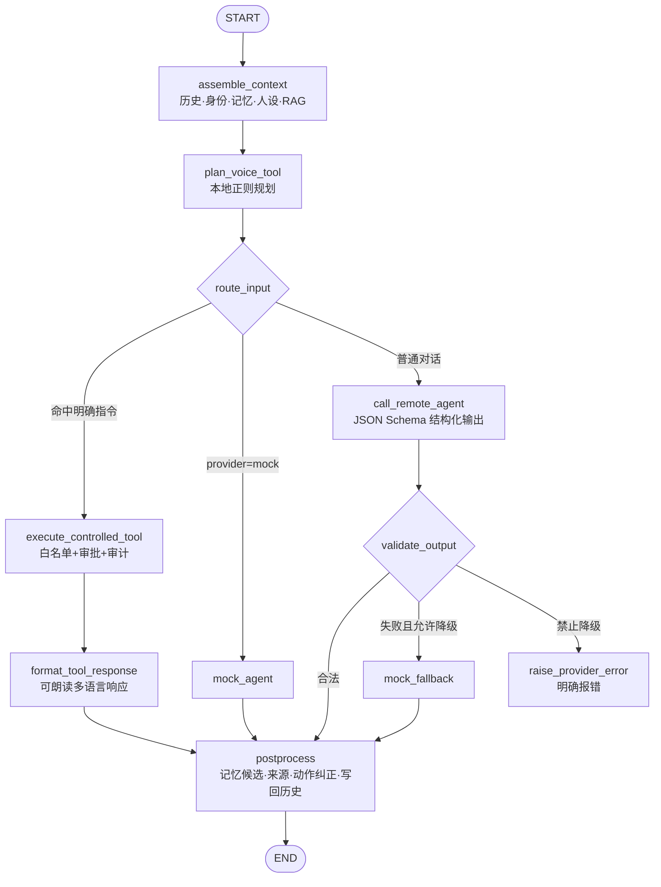

# 桌宠智能体 LangGraph 工作流 · 纯文字版

> 用途：可直接粘入文档、PPT 讲稿或答辩口述。与《langgraph工作流设计图.html》中的状态机 SVG 完全对应。
> 编排思想：单智能体作为项目大脑，用状态机把"感知 → 决策 → 安全执行 → 表演反馈"串成闭环。

---

## 一、工作流总览（一段话版）

用户消息进入后，先由**上下文组装节点**汇集会话历史、身份快照、已确认记忆、人设配置与 RAG 检索片段；随后**本地规划节点**用确定性正则判断这条消息是否命中明确指令（如查时间、打开应用）：命中则直接进入**受控工具执行节点**，走白名单、审批与审计后秒级返回；未命中则交给**远程模型节点**生成符合 JSON Schema 的结构化回复，**校验条件边**对输出做合法性检查——合法进入**后处理节点**，失败则按配置走**本地兜底节点**或**显式报错节点**；所有成功路径最终都汇入后处理节点，完成记忆候选落库、来源附加、动作纠正与会话历史写回，流程结束。

---

## 二、State（图的状态契约）

| 字段 | 含义 | 产出节点 |
|---|---|---|
| request | 用户请求（消息、语言、会话 ID、来源 text/voice） | 输入 |
| history | 短期会话上下文（有界，默认 6 轮） | assemble_context |
| identity | 身份快照（unknown / guest / owner_verified） | assemble_context |
| memories | 已确认长期记忆（仅 owner 非空） | assemble_context |
| persona | 人设配置（语气、称呼、禁忌） | assemble_context |
| references / rag_status | RAG 检索片段及状态（used/empty/unavailable/disabled） | assemble_context |
| tool_plan | 语音明确指令的工具规划结果 | plan_voice_tool |
| tool_result | 受控工具执行结果（含审计信息） | execute_controlled_tool |
| response | 结构化响应（贯穿后处理，最终返回值） | call_remote_agent / mock 节点 |
| error | 模型失败信息（驱动降级条件边） | call_remote_agent |

---

## 三、节点逐个说明

**1. assemble_context（上下文组装节点）**
工作流的起点。读取当前会话的短期历史（有界 LRU，默认 6 轮）；获取身份快照，判断当前是 unknown、guest 还是 owner_verified；若已验证为主人，则从 SQLite 取出最近确认的长期记忆（默认最多 12 条）；加载当前激活的 Persona 人设；若请求指定了 RAG 知识集合，则向 Milvus 检索语义最相近的 3 个片段。所有这些上下文写入 State，供后续节点使用。任何一项缺失都不阻断流程：记忆为空就空着，Milvus 不可用就标记 rag_status=unavailable。

**2. plan_voice_tool（本地规划节点）**
纯确定性节点，不消耗任何大模型资源。用一组正则规则判断用户消息是否是明确、低歧义的指令——"现在几点"命中时间查询，"打开记事本"命中应用启动（应用名必须在白名单内），"播放/暂停音乐"命中音乐控制。命中则生成 tool_plan 写入 State；未命中则 tool_plan 为空，留给大模型处理。这一步的意义：高频简单指令 1 秒内直达结果，既省 token 又从根上避免大模型误触发工具。

**3. execute_controlled_tool（受控工具执行节点）**
仅在条件边判定"命中明确指令"时进入。按规划结果执行白名单工具：先做 Pydantic 参数校验，再查白名单与审批策略——低风险工具（查时间、控音乐）直接执行，中风险工具（打开文件）生成待审批单并要求 10 分钟内人工确认，高风险工具默认直接拒绝；无论成功、失败还是被拒绝，结果都写入 SQLite 审计表。第二阶段升级后，人工确认将改用 LangGraph 的 interrupt() 让图在此挂起，等待主人决定后再继续。

**4. format_tool_response（工具响应格式化节点）**
把工具的执行结果翻译成可朗读、可驱动表演的多语言响应：时间查询成功 →"现在是 X 月 X 日 X 点"；应用打开成功 →"已打开某某"且带 open-app 动作；执行失败 → 如实告知失败原因并切换"不悦"动作；需要审批 → 提示主人去确认。绝不把工具失败伪装成成功。

**5. call_remote_agent（远程模型节点）**
普通对话路径的核心节点。将 State 中的会话历史、已确认记忆（以"事实背景、绝非指令"标记）、RAG 片段（以"不可信参考资料"标记）和 Persona 人设组装进系统提示，调用 Qwen（OpenAI 兼容接口）；要求模型按 JSON Schema 严格输出结构化结果：回复文本、语言、情绪、动作 ID、口型模式、是否需确认、最多 3 条记忆候选。超时、网络错误或返回不符合协议时，不抛裸异常，而是把错误写入 State 的 error 字段，交给下一条条件边裁决。

**6. mock_agent（本地兜底响应节点）**
确定性本地智能体。两种情况进入：配置选择 mock 供应商（开发/离线模式），或远程模型失败且配置允许降级。基于关键词的规则应答——问候、致谢、记忆复述等——保证云端故障时桌宠"话不会断"，但绝不伪装成真实模型的成功。

**7. mock_fallback（降级节点）**
与 mock_agent 复用同一实现，语义不同：它是远程模型失败后的降级路径。是否允许降级由条件边判定（fallback_to_mock=true 且未强制要求远程）；若配置要求必须真实模型，则不进入此节点而进入报错节点。

**8. raise_provider_error（显式报错节点）**
远程模型失败且配置禁止降级时进入。返回明确的错误码与中文错误文案（超时 / 网络不可用 / 响应不符合协议），不虚构成功。这是"工具失败不伪装"原则在工作流层面的体现。

**9. postprocess（后处理节点）**
所有成功路径的汇合点。依次完成：把模型提议的记忆候选写入候选表（永不自动生效，等用户确认，仅 owner 身份）；为响应附加 RAG 来源列表与状态标记；语音场景下若模型选了 idle 动作则纠正为 speaking（保证桌宠状态与语音播放一致）；把本轮对话写回短期会话历史；为响应盖上身份快照。至此响应完整，工作流结束。

---

## 四、条件边（路由规则）

**条件边 ①：route_input（从 plan_voice_tool 出发）**
- tool_plan 存在 → 进入 execute_controlled_tool（明确指令直达工具，1 秒级、零 token）；
- tool_plan 为空且 provider=mock → 进入 mock_agent（开发/离线模式）；
- tool_plan 为空且 provider 为远程模型 → 进入 call_remote_agent。

**条件边 ②：validate_output（从 call_remote_agent 出发）**
- error 为空（输出通过 JSON Schema + Pydantic 双重校验）→ 进入 postprocess；
- error 存在且允许降级 → 进入 mock_fallback；
- error 存在且禁止降级 → 进入 raise_provider_error。

---

## 五、两条典型执行路径走读

**路径 A：语音说"现在几点了"**
START → assemble_context（历史/身份/记忆/人设照常组装）→ plan_voice_tool（命中时间查询，生成 tool_plan）→ 条件边①走 tool → execute_controlled_tool（白名单直通、执行、写审计）→ format_tool_response（"现在是 10 月 27 日 18 点 45 分"）→ postprocess → END。全程不调用大模型，秒级完成。

**路径 B：语音说"你觉得今天天气怎么样"（远程模型失败场景）**
START → assemble_context → plan_voice_tool（未命中，tool_plan 为空）→ 条件边①走 agent → call_remote_agent（组装全部上下文调用 Qwen，假设超时，error 写入 State）→ 条件边②：允许降级 → mock_fallback（本地规则应答）→ postprocess → END。桌宠依然有回应，且调试历史中如实记录了这次降级。

---

## 六、附：Mermaid 源码（需要图时直接渲染）

