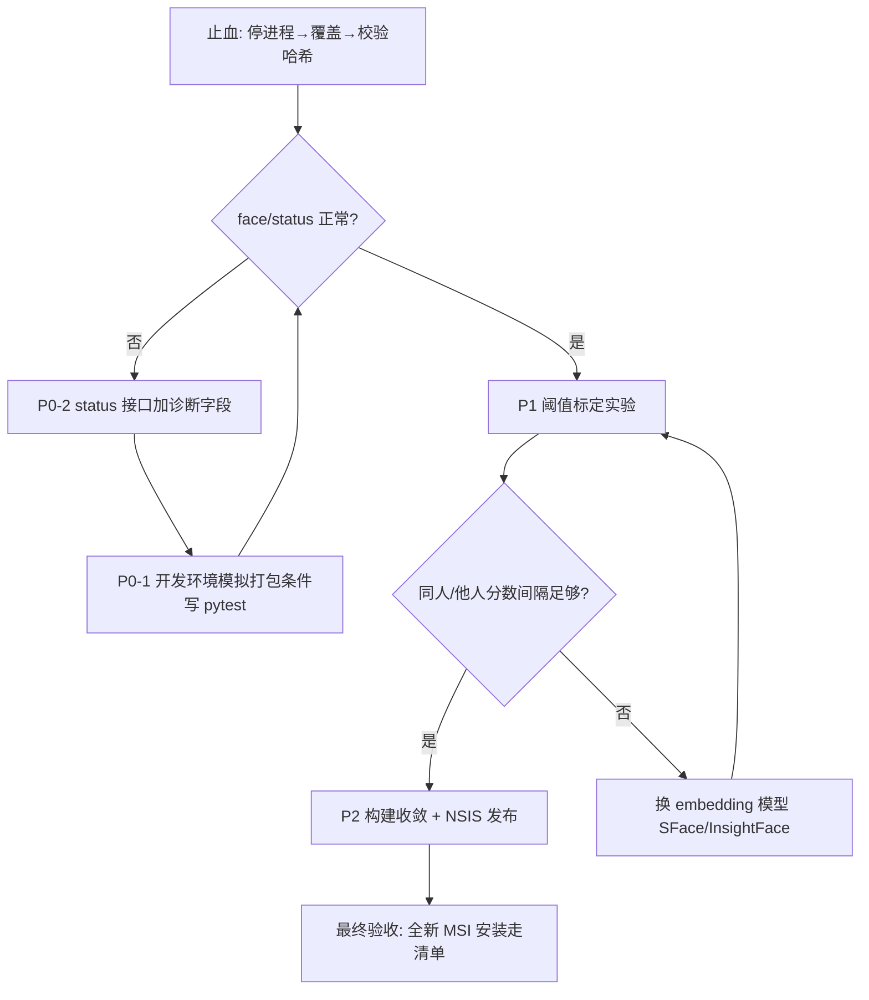

# 人脸识别迭代方案（卡点根因分析与正确迭代路径）

**版本**：v1.0 ｜ **日期**：2026-10-16 ｜ **前置**：声纹模块已归档至 `voiceprint-archive/`，人脸模块代码已基本就绪

---

## 一、卡点根因分析（按证据说话）

### 根因 1（决定性证据）：热替换时 gateway 进程未停，锁文件导致覆盖静默失败

对 `desktop-pet-gateway.exe` 做了字节级比对：

| 文件                          | dist（最新构建）        | 安装目录                        | 结论             |
| --------------------------- | ----------------- | --------------------------- | -------------- |
| desktop-pet-gateway.exe     | **25,119,679** 字节 | **25,118,687** 字节（差 992 字节） | **安装目录是旧 exe** |
| models/face_landmarker.task | 3,758,596 字节      | 3,758,596 字节                | 模型一致（数据文件未被锁）  |

所有代码修复（`_face_engine()` 改用 `resolve_model_path`、健康检查修正等）都打包进了**新 exe**，但历次 robocopy 热替换时 `desktop-pet-gateway` 进程仍在运行——Windows 锁定运行中的 exe，`robocopy /R:2 /W:2` 重试后**静默跳过**，旧代码一直在跑。这就是"改了三轮、替换了四次、仍然 503"的直接原因：**不是修复无效，是修复从未被加载过**。

### 根因 2：错误不可诊断

`/api/face/status` 与 503 响应只报"人脸模型文件不存在"，不返回"尝试过哪些候选路径、每条是否存在、mediapipe 是否 import 成功"，导致只能靠猜。

### 根因 3：用"打包 + 热替换"循环调试代码 bug

每轮循环 = 改代码 → PyInstaller 全量重打（含 2400 个文件）→ UAC 提权 robocopy → 重启验证，单轮 10 分钟以上且引入根因 1 的风险。代码 bug（路径解析）本应在开发环境用测试用例定位。

### 根因 4：构建脚本双轨制与易碎步骤

- `desktop-pet-gateway.spec` 与 `build-gateway.ps1` 命令行两套打包方式并存，spec 的修改曾长期未生效；
- 构建脚本 `--clean` 每次清空 dist，模型复制步骤曾因 `$projectRoot/$PSScriptRoot` 解析问题失败且**只 WARNING 不报错**，产物可能带着缺模型的假成功。

### 根因 5：发布通道未决

MSI（WiX 32 位 `light.exe` 处理 662MB / 2400 文件内存崩溃）→ NSIS（工具下载网络失败）→ UAC robocopy 热更新，三条路都走到一半。打包通道不收敛，每次发布都是冒险。

### 附：打包环境路径解析机制（已确认，非问题）

Tauri 启动 gateway 时（`lib.rs`）设置 `DESKTOP_PET_CONFIG_DIR` / `DESKTOP_PET_DATA_DIR` 并指定工作目录，因此 `settings.face_recognition_model_path` 在打包环境下必然指向 `%LOCALAPPDATA%` 下不存在的路径——**任何直接用 `settings.*.exists()` 判断模型是否可用的代码在打包后必返回 false**，必须统一走 `resolve_model_path()`（exe 同目录 → `_internal` → `_MEIPASS`）。

---

## 二、立即止血（预计 15 分钟，大概率直接恢复功能）

```powershell
# 1. 完全退出应用（含托盘图标），并确认进程已消失
Get-Process "desktop-pet-gateway","canvas-desktop-pet" -ErrorAction SilentlyContinue | Stop-Process -Force
Get-Process "desktop-pet-gateway" -ErrorAction SilentlyContinue   # 应无输出

# 2. 重新覆盖（此时无进程锁定）
robocopy "E:\Anime‑style AI Agent Desktop Pet\backend\dist\desktop-pet-gateway" `
  "C:\Program Files\Anime Agent Desktop Pet\gateway" /E /IS /IT /IM /MT:4 /R:2 /W:2

# 3. 校验 exe 字节数必须等于 25119679
(Get-Item "C:\Program Files\Anime Agent Desktop Pet\gateway\desktop-pet-gateway.exe").Length

# 4. 启动应用，访问 /api/face/status
```

**若仍失败**：此时才是真正的调试起点——先给 status 接口加诊断字段（见 P0-2），在**开发环境**复现，不再打包装回安装目录试。

---

## 三、修正后的迭代路径



### P0（本周内，2026-10-18 前）

| #    | 任务                   | 说明                                                                                                                        | 负责人 | 截止         |
| ---- | -------------------- | ------------------------------------------------------------------------------------------------------------------------- | --- | ---------- |
| P0-1 | 停止打包调试循环             | 人脸功能验证一律走开发模式（`uvicorn` + `vite dev`）；在开发环境用 pytest 模拟打包三条件（`sys.frozen=True`、工作目录非项目根、配置路径不存在）固定 `resolve_model_path` 行为 | 待确认 | 2026-10-17 |
| P0-2 | status 接口加诊断能力       | 返回：候选路径列表及各自存在性、mediapipe/cv2 import 结果、模型文件字节数；gateway stdout/stderr 落 `runtime/logs`                                    | 待确认 | 2026-10-17 |
| P0-3 | 热替换守则固化              | 替换前三步：停进程 → 覆盖 → **校验关键文件哈希/字节数**；脚本化（scripts/hot-update.ps1 补校验与失败即报），禁止静默跳过                                             | 待确认 | 2026-10-17 |
| P0-4 | requirements.txt 补依赖 | 补 `mediapipe`、`opencv-python`；**锁定 Python 3.12**（mediapipe 官方 wheel 不支持 3.13），在 README 标注                                 | 待确认 | 2026-10-18 |

### P1（2026-10-21 前）——功能正确性

| #    | 任务             | 说明                                                                                                                                                          | 负责人 | 截止         |
| ---- | -------------- | ----------------------------------------------------------------------------------------------------------------------------------------------------------- | --- | ---------- |
| P1-1 | 阈值标定实验         | 同一人 5 张（不同表情/角度/光照）vs 他人 5 张，记录余弦相似度分布。**判定标准：两类分布之间的间隔(gap)必须明显**                                                                                          | 待确认 | 2026-10-19 |
| P1-2 | 视标定结果决定是否换特征方案 | FaceLandmarker 是**几何关键点**，不是身份嵌入(embedding)，区分度天然不足——这是本方案最大的技术风险。若 gap 不足：保留 MediaPipe 做检测/对齐/实时感知，验证特征换 OpenCV SFace 或 InsightFace（均可离线 + PyInstaller 打包） | 待确认 | 2026-10-21 |
| P1-3 | 补测试            | 后端 face 模块单测（特征归一化、profile store、mock 验证路径）；前端 `FaceAuthClient` 补 `.test.ts`——回归项目 120+143 测试基线惯例                                                           | 待确认 | 2026-10-21 |

### P2（2026-10-24 前）——发布收敛

| #    | 任务                | 说明                                                                                                                       | 负责人 | 截止         |
| ---- | ----------------- | ------------------------------------------------------------------------------------------------------------------------ | --- | ---------- |
| P2-1 | 精简 mediapipe 打包体积 | `collect_all('mediapipe')` 收进了大量模型/测试数据/文档；改用精准收集（binaries + hiddenimports + 必要 .task 模型），gateway 文件数与体积可大幅下降，WiX 压力随之减小 | 待确认 | 2026-10-22 |
| P2-2 | 发布通道决策            | 首选：Tauri 切 NSIS（`tauri.conf.json` → `"targets": ["nsis"]`，对大文件更稳；NSIS 工具可手动下载解压绕过网络问题）。备选：精简后重试 WiX                      | 待确认 | 2026-10-22 |
| P2-3 | 端到端验收             | 全新安装 → `face/status configured=true` → 注册 3 张 → 正样本通过 / 非主人拒绝（各 ≥5 次）→ 旧声纹配置清理确认                                         | 待确认 | 2026-10-24 |

---

## 四、验收标准（P2-3 通过条件）

1. 全新安装后 `/api/face/status` 返回 `configured: true`；
2. 注册 3 张人脸成功，档案落 `face_profile.json`；
3. 主人正样本通过率 ≥ 95%（≥5 次实测）；
4. 非主人样本误识率 = 0（≥5 次实测）；
5. 身份变为 `owner_verified` 后私有记忆/受控工具解锁，审批流程不被绕过；
6. 人脸注册/验证/删除事件均出现在身份审计记录中；
7. MSI 卸载重装不丢失用户运行配置。

---

## 五、经验沉淀

1. **"替换了但没生效"永远先怀疑进程锁与文件一致性**，用字节数/哈希说话，不要反复重打包。
2. **调试环境与验证环境必须分离**：代码 bug 在开发环境用测试修，打包只做验收。
3. **失败要可诊断**：503 必须带候选路径明细，否则每次排查都是盲猜。
4. **构建产物自校验**：构建脚本最后一步必须校验关键产物（模型文件存在、字节数合理）否则视为构建失败。

---

## 六、执行进度（2026-10-16 更新）

### 已完成

| 项 | 状态 | 落地内容 |
|---|---|---|
| P0-1 停止打包调试 | ✅ | `resolve_model_path` 支持“配置路径→exe 同目录→`_internal`→`_MEIPASS`”，新增打包三条件 pytest（`backend/tests/test_face_recognition.py`，含 frozen、工作目录非项目根、配置路径不存在） |
| P0-2 status 诊断 | ✅ | `/api/face/status` 与模型缺失 503 返回 `diagnostics`：全部候选路径/存在性/字节数、mediapipe 与 cv2 实际导入结果与版本、cwd/frozen/executable/meipass |
| P0-2 网关日志 | ✅ | Tauri 启动网关时 stdout/stderr 落 `%LOCALAPPDATA%\AnimeAgentDesktopPet\logs\gateway.log`（开发态落 `runtime/logs`） |
| P0-3 热替换守则 | ✅ | `scripts/hot-update.ps1` 重写：强制管理员、先停 `desktop-pet-gateway`/`canvas-desktop-pet`、robocopy 退出码 `>=8` 即失败、复制后校验 exe 与模型 SHA256/字节数 |
| P0-4 依赖 | ✅ | `requirements.txt` 补 mediapipe/opencv-python/numpy，新增 `.python-version` 锁定 3.12.10，README 标注 Python 3.12 |
| P1-1 阈值标定 | ✅ | 真实样本（主人 3、他人 5）实测：几何关键点 gap=**−0.0086**（他人最高 0.9863 > 主人最低 0.9777）不可分；SFace gap=**+0.4096**，结论明确。工具：`backend/app/face_calibration.py` + `scripts/face_threshold_calibration.py`（留一法，附单测） |
| P1-2 切换身份嵌入 | ✅ | 已切 OpenCV **YuNet 检测 + SFace 128 维身份嵌入**（`SFaceFaceEngine`）；MediaPipe 引擎保留但不用于身份认证、默认不打包；阈值默认 0.45；旧 1434 维档案自动判失效并要求重新注册 |
| P1-3 测试 | ✅ | 后端全量 178 通过；前端 `FaceAuthClient.test.ts` 6 用例，全量 145 通过 |
| P2-1 精简打包 | ✅ | 收敛为 `desktop-pet-gateway.spec` 单一通道；身份链路只留 OpenCV，不打包 mediapipe，剔除 matplotlib/pandas/PIL/tkinter/sounddevice 与 ffmpeg。**产物 373.7MB/2400 文件 → 236.4MB/882 文件**；打包 exe 真实冒烟：主人 3/3 通过、他人 5/5 拒绝 |
| P2-2 发布通道 | ✅（已产出安装包） | `tauri.conf.json` 切 `targets:["nsis"]`，`build-desktop.ps1` 改 `--bundles nsis`；`npm run desktop:build` 全程跑通（网关→前端→Rust release→自动下载 NSIS 工具链→makensis），产物 `src-tauri/.tauri-target-user/release/bundle/nsis/Anime Agent Desktop Pet_0.4.0_x64-setup.exe`（约 608MB），不再出现 WiX 内存崩溃 |
| 安全旁路修复 | ✅ | 开发期 `DESKTOP_PET_TEMP_OPEN_ACCESS=true` 会让任意验证返回 `owner_verified`，默认改为 `false`（`.env.example` 同步），满足验收标准 5 |
| 模型下载 | ✅ | `scripts/download_face_models.py`：多镜像下载 YuNet/SFace ONNX 并校验文件头/大小，防止 HTML 错误页被当成模型 |

### 待人工执行 / 待决策

1. **止血热替换（需管理员，沙箱内无法弹 UAC）**：当前安装目录仍是旧 exe（25,118,687 字节）。请用管理员 PowerShell 执行：
   ```powershell
   powershell -ExecutionPolicy Bypass -File scripts\hot-update.ps1 -ProjectRoot "E:\Anime‑style AI Agent Desktop Pet"
   ```
   脚本会停进程、覆盖并校验哈希；完成后启动应用访问 `/api/face/status`，应看到 `configured=true`。
2. **扩充样本复标（建议）**：现主人仅 3 张，已足以判定方案切换；正式定阈值前建议补到主人 5 张（不同表情/角度/光照）+ 他人 5 张以上，用 `scripts/face_threshold_calibration.py` 复标后再微调（现阈值 0.45，两侧余量 >0.2）。
3. **P2-3 端到端验收（待人工在全新环境执行）**：用产出的 NSIS 安装包做一次“卸载旧版 → 全新安装 → 注册 3 张 → 主人/非主人各 ≥5 次 → 审计记录 → 卸载重装配置保留”全流程。配置与档案在 `%LOCALAPPDATA%\AnimeAgentDesktopPet`（NSIS 卸载默认不删该目录，天然满足配置保留；验收时仍需实测确认）。
   安装后快速自检：浏览器访问 `http://127.0.0.1:8000/api/face/status`，应 `configured=true`，`diagnostics.backend="sface"`，YuNet/SFace 两个模型 `path` 非空。

### 完整构建方式

```powershell
python scripts/download_face_models.py   # 首次：下载 YuNet/SFace ONNX
npm run desktop:build                    # 网关+前端+Rust+NSIS 一条龙
```

构建过程踩坑记录：
- npm 嵌套启动的 PowerShell 会话里 `Get-FileHash` 曾无法自动加载，导致校验阶段静默终止、后续 Tauri 阶段不执行；已改用不依赖模块的 .NET SHA256（`Get-Sha256Hex`），并在 `build-desktop.ps1` 加阶段日志与失败即 `throw`。
- 项目路径含 Unicode 特殊连字符（U+2011），网关与 Cargo 打包都先 `subst` 到 ASCII 盘符（Z:）再构建。

### 本轮关键证据

同一批样本两种特征方案对比（余弦相似度）：

| 方案 | 主人最低 | 他人最高 | gap | 结论 |
|---|---|---|---|---|
| FaceLandmarker 几何点 | 0.9777 | 0.9863（5 人中 3 人 >0.985） | **−0.0086** | 完全重叠，不可用 |
| **SFace 身份嵌入** | 0.6543（mean 0.6826） | 0.2447（mean 0.1343） | **+0.4096** | 明显可分 |

- 打包 exe（frozen）冒烟：模型从 exe 同目录 `models/` 解析；注册 3 张主人后主人 3/3 返回 `owner_verified`、他人 5/5 返回 `guest`。
- 工程坑 1：OpenCV DNN 在 Windows 下无法打开含 Unicode 特殊连字符（U+2011）的模型路径，需复制到 ASCII 临时目录（`_stage_model_for_opencv`，按 SHA256 缓存）。
- 工程坑 2：YuNet 默认检测阈值 0.9 会漏检普通光照/侧脸正脸，降到 0.6（NMS 0.3 仍抑制重复框）。
- 历史坑（切 SFace 后已不相关）：mediapipe `vision/__init__` 强依赖仅绘图用的 matplotlib，曾用 runtime hook 打桩；默认包已不含 mediapipe，该 hook 已删除。
