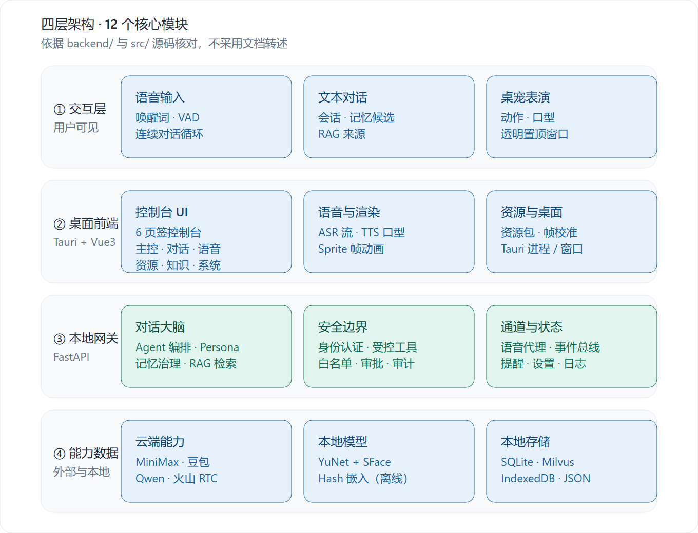
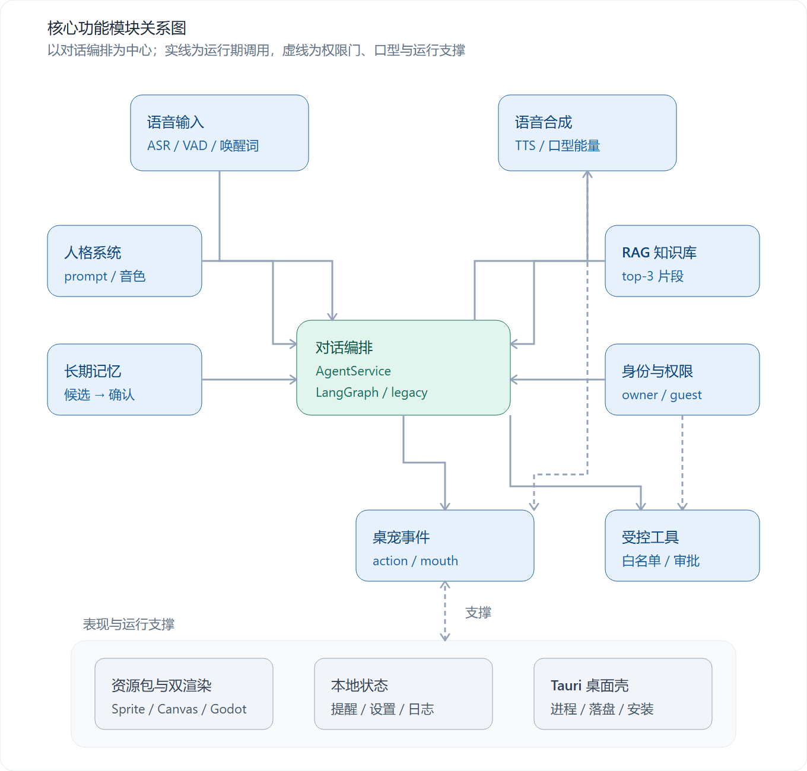
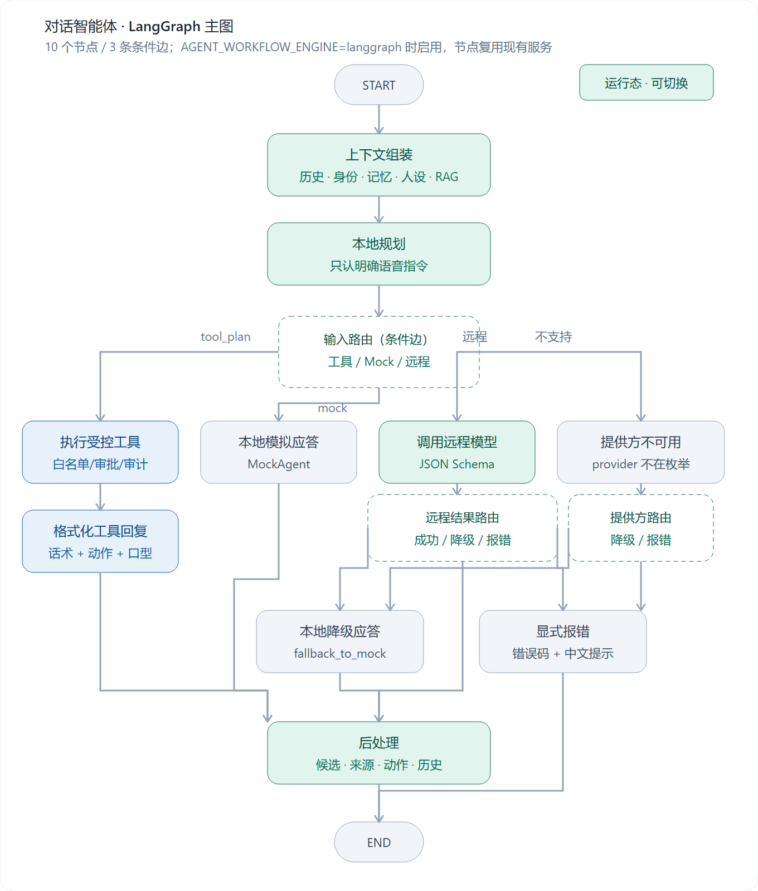
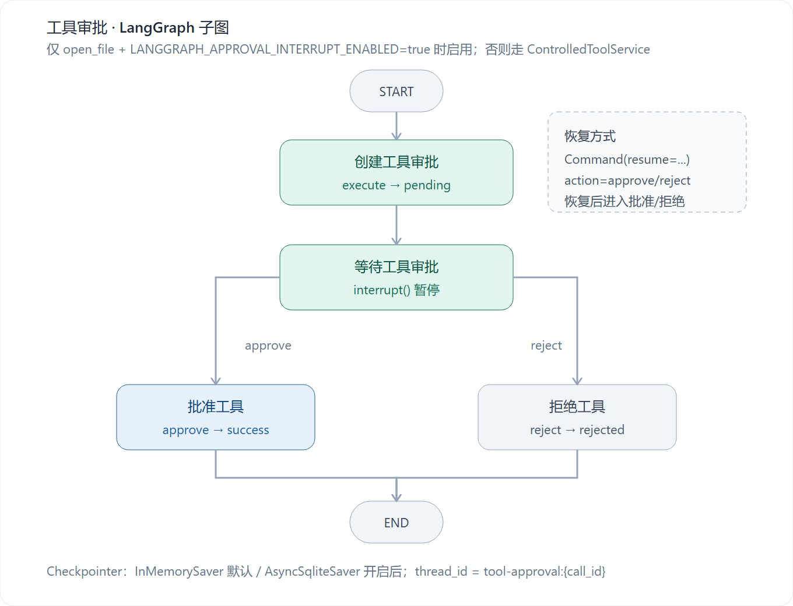
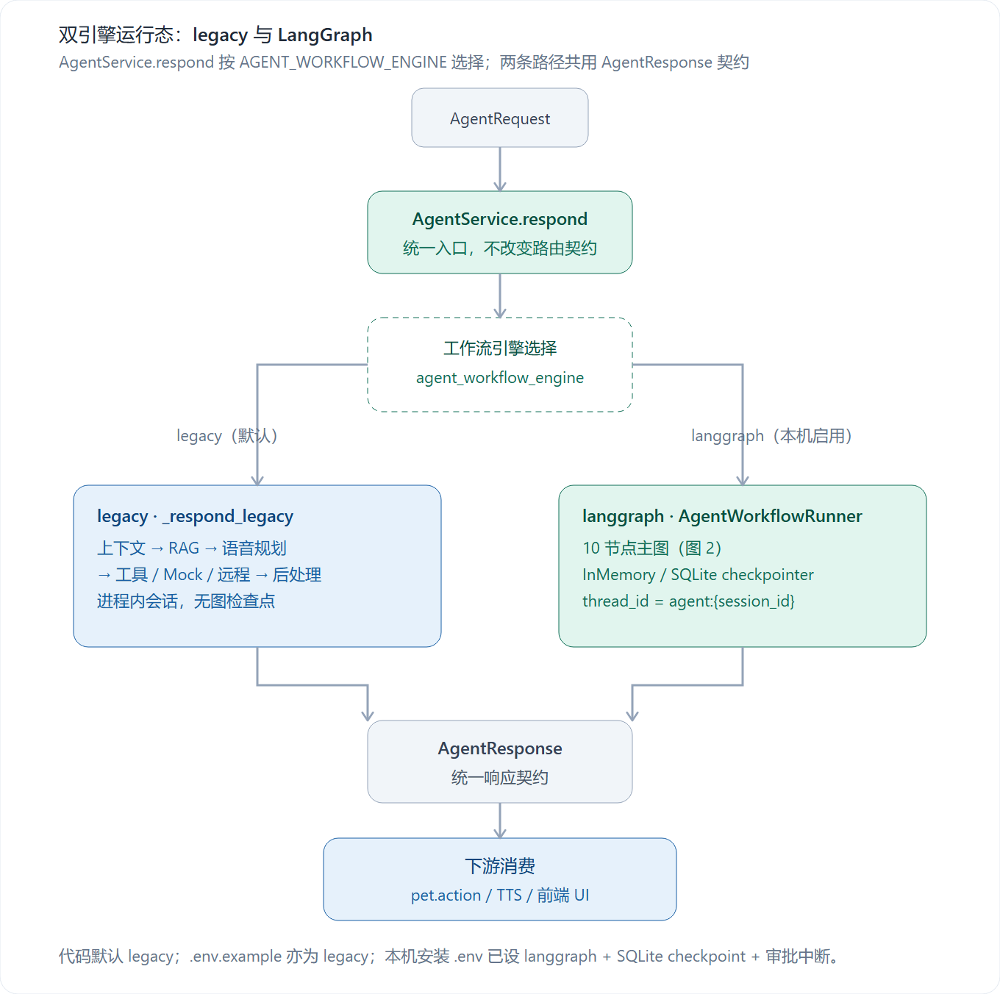

# 灵梦桌宠 · 核心功能模块分析

> 版本：v1.0 ｜ 日期：2026-11-03
> 分析对象：灵梦桌宠
> 分析范围：`backend/app`、`src`、`src-tauri/src`、`godot/pet_client`
> 分析方法：逐模块对照源码；`docs/` 既有文档与 PRD 仅作参考，凡与代码不一致处已在第 9 节标注。

## 目录

1. [结论摘要](#1-结论摘要)
2. [技术栈与运行形态](#2-技术栈与运行形态)
3. [模块总览](#3-模块总览)
4. [模块详解](#4-模块详解)
5. [三条主链路](#5-三条主链路)
6. [图示：模块关系与 LangGraph 工作流](#6-图示模块关系与-langgraph-工作流)
7. [关键模块耦合](#7-关键模块耦合)
8. [设计取舍](#8-设计取舍)
9. [实现核对与风险（内部参考）](#9-实现核对与风险内部参考)
10. [附录：关键文件索引](#10-附录关键文件索引)

---

## 1. 结论摘要

- 项目不是单一桌宠应用，而是 **桌面壳 + 前端控制台 + 本地网关 + Godot 渲染** 的四层结构，共 **12 个可独立拆分的核心模块**。
- 业务重心在 FastAPI 本地网关：**62 个路由（59 个 REST + 3 个 WebSocket）**，承载语音代理、对话编排、人格、记忆、RAG、受控工具、身份与本地状态。
- 前端是“控制台 + 舞台”：`App.vue` **4657 行**、6 个页签；`src/*/` 客户端层边界清晰，UI 层尚未按页签拆分。
- 安全边界是项目最强差异点：模型只输出结构化结果，**不持有工具执行通道**；桌面工具经参数校验、身份/白名单、审批、审计四层。
- 对话编排已落地双引擎：`legacy` 顺序链路保留回退，LangGraph 主图（10 节点 / 3 条条件边）与工具审批子图（4 节点 / interrupt）通过配置切换；本机安装配置已启用 `langgraph`。
- 工程化程度：**24 个后端测试文件、37 个前端测试文件**、E2E 验收脚本、PyInstaller + NSIS 打包；Godot **4.7.2**（GL Compatibility）。
- 全文含 **5 张图**：第 2 节 1 张四层模块地图（图 0），第 6 节 4 张（图 1 模块关系、图 2 LangGraph 主图、图 3 工具审批子图、图 4 双引擎运行态），均提供 PNG 预览与 SVG 矢量源。

## 2. 技术栈与运行形态

| 层 | 技术 | 在项目中的具体作用 |
|---|---|---|
| 桌面壳 | Tauri 2（Rust） | 启动/停止网关与 Godot 子进程、资源包原子落盘、窗口尺寸与吸附、NSIS 打包 |
| 前端 | Vue 3 + TypeScript + Vite | 6 页签控制台、语音/人脸/工具/记忆/RAG 交互、Canvas 预览、调试历史 |
| 网关 | FastAPI + Pydantic v2 + httpx/aiohttp | 62 个路由、请求校验、供应商代理、WebSocket 事件、SQLite 持久化 |
| 工作流 | LangGraph 1.2 + langgraph-checkpoint-sqlite 3.1 | 主图 10 节点、审批子图 4 节点；InMemory 默认 / SQLite 可选检查点 |
| 渲染 | Godot 4.7.2（GDScript，GL Compatibility） | 透明置顶桌宠窗口、动作状态机、SpriteSheet 播放、拖拽/吸附/自主漫游 |
| 数据 | SQLite / Milvus / IndexedDB | 记忆、人格、工具审批审计、提醒设置、RAG 向量、前端资源包缓存 |
| 云端 | 豆包 SAUC / MiniMax / Qwen / 火山 RTC | 流式 ASR、TTS、结构化对话、可选声纹验证 |
| 本地模型 | OpenCV YuNet + SFace | 人脸检测与 128 维身份嵌入，完全离线 |

**运行形态**：Tauri 主窗口加载 Vue3 控制台；Rust 侧拉起 `desktop-pet-gateway`（FastAPI，默认 `127.0.0.1:8000`）与 Godot 桌宠进程。网关内对话编排按 `AGENT_WORKFLOW_ENGINE` 在 `legacy` 与 LangGraph 主图之间切换；本机安装配置为 `langgraph`。前端只访问本地网关，供应商密钥仅存在于服务端 `.env`，不下发浏览器。

*矢量源：`assets/module-map.svg`*

图 0：四层模块地图（按层展示组成；运行期关系见图 1）

## 3. 模块总览

| 层 | # | 模块 | 核心职责 | 关键代码 |
|---|---|---|---|---|
| 交互与表演 | 1 | 语音输入与识别 | 采集、VAD 断句、唤醒词门控、流式 ASR | `src/voice/`、`backend/app/doubao_asr.py` |
| 交互与表演 | 2 | 语音合成与口型 | 多音色 TTS、WebAudio 播放、口型能量 | `SpeechPlaybackCoordinator.ts`、`AudioLipSyncPlayer.ts` |
| 交互与表演 | 3 | 桌宠事件总线 | 统一动作协议、WS 广播、Canvas/Godot 消费 | `backend/app/pet_events.py`、`PetEventGateway.ts` |
| 交互与表演 | 4 | 资源包与双渲染 | SpriteSheet 校验、帧校准、持久化、Godot 同步 | `src/engine/`、`godot/pet_client/` |
| 智能与知识 | 5 | 对话编排 | 上下文组装、模型调用、结构化输出、降级、LangGraph 编排 | `backend/app/agent.py`、`backend/app/agent_workflow/` |
| 智能与知识 | 6 | 人格系统 | 人设配置、激活、版本回滚、提示词注入 | `backend/app/persona.py` |
| 智能与知识 | 7 | 长期记忆 | 候选制记忆、敏感拦截、确认后注入 | `backend/app/memory.py` |
| 智能与知识 | 8 | RAG 知识库 | 双集合、切片、嵌入、Milvus 检索 | `backend/app/rag.py` |
| 安全与状态 | 9 | 身份与权限 | 人脸/声纹验证、身份状态机、权限位 | `identity.py`、`face_recognition.py` |
| 安全与状态 | 10 | 受控桌面工具 | 白名单、风险分级、审批、审计、interrupt 审批 | `controlled_tools.py`、`voice_tool_planner.py`、`agent_workflow/approval_graph.py` |
| 安全与状态 | 11 | 本地状态 | 提醒调度、设置、系统日志 | `backend/app/local_state.py` |
| 桌面集成 | 12 | Tauri 桌面壳 | 双进程管理、资源落盘、窗口、打包 | `src-tauri/src/lib.rs` |

## 4. 模块详解

### 4.1 交互与表演层

#### 4.1.1 语音输入与识别

- **职责**：完成“麦克风 → 文本”的采集、门控、断句与识别，是语音对话的入口。
- **关键实现**：`AudioRecorder.ts`（ScriptProcessor 4096、重采样 16 kHz、PCM16 WAV）；`VoiceActivityDetector.ts`（RMS + 700 ms 噪声校准 + 自适应阈值，静音 0.9/1.2 s 断句、单句上限 15 s）；`WakeWordGate.ts`（“小赤红”等文本级唤醒词）；`SpeechGatewayClient.createAsrStream`（WS `/api/speech/asr/stream`）；`doubao_asr.py` + `doubao_sauc_protocol.py`（网关按 200 ms 分片对接豆包 SAUC）。
- **输入 → 输出**：麦克风 Float32 帧 → 16 kHz WAV → WS `start`/`audio`/`stop` → `partial`/`final` 文本。
- **依赖关系**：依赖豆包 SAUC 配置与网关健康检查；输出交给对话编排；连续对话循环由 `App.vue` 的 `toggleContinuousConversation` 驱动。
- **实现状态**：已落地。注意两点：唤醒词是识别后的**文本门控**，不是声学唤醒词；音频在 VAD 断句后整段上传，由网关流式送云端，并非麦克风全程实时上行。

#### 4.1.2 语音合成与口型同步

- **职责**：把回复文本合成为语音并驱动口型，是“表演”的音频侧。
- **关键实现**：`SpeechPlaybackCoordinator.ts`（请求序号防串音、状态机 `synthesizing/playing/idle/error`）；`AudioLipSyncPlayer.ts`（AudioContext + AnalyserNode，RMS 阈值 0.045/0.14 映射 `closed/half-open/open`）；`SpeechGatewayClient.synthesize`（`/api/speech/tts`）；`provider.py`（MiniMax `/t2a_v2`，返回 hex 音频）；`personaVoices.ts`（中/日/英多音色）。
- **输入 → 输出**：文本 + language + voice 参数 → hex 音频 → WebAudio 播放 → 口型事件。
- **依赖关系**：依赖 MiniMax 配置与人格 `voice_id`；口型状态经桌宠事件或 Tauri `preview.json` 同步到 Godot。
- **实现状态**：已落地。文本对话也会调用 TTS，并非只有语音模式播报。

#### 4.1.3 桌宠事件总线

- **职责**：把业务结果统一翻译为动作事件，解耦业务逻辑与 Canvas/Godot 渲染。
- **关键实现**：`pet_events.py`（`PetActionEvent` 13 种动作、3 种口型、0–600000 ms；`PetEventHub` 连接集合 + `asyncio.Lock` 广播）；`POST/WS /api/pet/events`；`agent_events` 在回复后广播 `pet.action`；`ReminderDispatcher` 广播 `reminder`；前端 `PetEventGateway.ts`；Godot `PetEventBridge.gd` / `PetController.gd`。
- **输入 → 输出**：`action_id/emotion/mouth_mode/duration/interruptible` → WS 客户端 / Godot 状态机。
- **依赖关系**：被对话编排、提醒、前端动作选择依赖；桌面模式另走 Tauri `preview.json`。
- **实现状态**：已落地。动作枚举在后端、前端资源包、Godot 三处分别维护（见第 9 节）。

#### 4.1.4 资源包与双渲染

- **职责**：把角色 SpriteSheet 与动作清单变成可预览、可落盘、可由 Godot 消费的资源包。
- **关键实现**：`engine/ResourcePackage.ts`（manifest 解析/导出）、`ManifestValidator.ts`（清单校验）、`SpriteAnimator.ts`（帧动画）、`ResourcePackageStorage.ts`（IndexedDB 持久化）、`PetCanvas.vue`（Canvas 预览）；Tauri `sync_godot_resource_package`（PNG/JSON 临时文件 + 原子替换）；Godot `SpriteManifestLoader.gd` / `SpriteResourcePackage.gd`。
- **输入 → 输出**：PNG + `manifest.json` → 校验后的 manifest → Canvas 帧序列 / Godot 资源目录。
- **依赖关系**：依赖 Tauri 写盘与 Godot 读取；动作协议与桌宠事件共享枚举。
- **实现状态**：已落地。资源包动作 23 个（13 个通用动作 + 6 向行走 + 4 个过渡），事件动作 13 个。

### 4.2 智能与知识层

#### 4.2.1 对话编排

- **职责**：统一文本/语音入口，组装上下文，调用模型并把输出约束为可展示、可表演、可审计的结构化回复。
- **关键实现**：`agent.py` 的 `AgentService.respond` 按 `AGENT_WORKFLOW_ENGINE` 选择 `_respond_legacy` 或 `AgentWorkflowRunner.run`；LangGraph 主图由 `agent_workflow/runner.py` 编译，含 10 个中文节点和 3 条条件边；`AgentRequest`/`AgentResponse`；`ConversationMemory`（6 轮、100 会话、进程内）；`MockAgent`/`OpenAiCompatibleAgent`；`agent_events.py`；`/api/agent/chat` 与 WS `/api/agent/events`。
- **状态与检查点**：`AgentWorkflowState` 承载 request、history、identity、memories、persona、sources、references、rag_status、tool_plan、tool_result、response、error；线程标识为 `agent:{session_id}`，默认 `InMemorySaver`，开启 `LANGGRAPH_CHECKPOINT_ENABLED` 后写 SQLite。
- **输入 → 输出**：message/language/session_id/source/rag_collection → text/emotion/action_id/mouth_mode/sources/rag_status/memory_candidates/trace_id。
- **依赖关系**：依赖人格、记忆、RAG、身份、工具；输出被 TTS、桌宠事件、前端对话面板消费。
- **实现状态**：双引擎已落地。代码默认 `legacy` 以保留回退，显式设置 `AGENT_WORKFLOW_ENGINE=langgraph` 后进入主图；本机安装配置已启用 `langgraph`。两条路径共用同一批服务和 `AgentResponse` 契约，LangGraph 不新增安全边界。

#### 4.2.2 人格系统

- **职责**：把角色设定、说话风格、音色、默认动作变成可配置、可版本回滚的人设档案。
- **关键实现**：`persona.py` 的 `PersonaStore`（`persona_profiles` + `persona_profile_versions` 两张 SQLite 表）；`build_persona_prompt_block`；`/api/personas/*`；前端人格工作台。
- **输入 → 输出**：`PersonaProfileDraft` → 激活人格 → system prompt 区块 + `voice_id` + `default_action`。
- **依赖关系**：被对话编排每轮读取；`MockAgent` 用 `character_name`；语音链路用 `voice_id`；不参与身份/工具/RAG 权限。
- **实现状态**：已落地。单活人格；更新前与回滚前各写一次快照。

#### 4.2.3 长期记忆

- **职责**：在“模型提议、用户决定”的前提下沉淀跨会话事实与偏好。
- **关键实现**：`memory.py` 的 `MemoryStore`（候选表 + 确认表）；`SENSITIVE_MEMORY_PATTERN` 与卡号正则；`/api/memories/*`；`AgentService` 注入最近 12 条确认记忆。
- **输入 → 输出**：模型 `memory_candidates`（≤3）→ 候选 → 用户确认 → 确认记忆 → 后续对话上下文。
- **依赖关系**：仅 `owner_verified` 可用；依赖 SQLite；被对话编排消费。
- **实现状态**：已落地。候选永不自动确认；敏感内容入库前拦截。

#### 4.2.4 RAG 知识库

- **职责**：为对话补充角色设定与用户文档两类外部知识，且把检索内容当“资料”而非“指令”。
- **关键实现**：`rag.py` 的 `RagService`/`MilvusRagStore`/`HashEmbeddingAdapter`/`OpenAiCompatibleEmbeddingAdapter`；`split_document`（900 字/120 重叠）；`/api/rag/*`。
- **输入 → 输出**：UTF-8 txt/md（≤5 MB）→ 切片 + 向量 → Milvus；query → top-3 → sources + references。
- **依赖关系**：依赖 Milvus；被对话编排在指定 `rag_collection` 时调用；RAG 不可用不影响聊天。
- **实现状态**：已落地。默认 hash 嵌入用于离线验证，生产需换 OpenAI 兼容嵌入；同集合按内容哈希去重。

### 4.3 安全与状态层

#### 4.3.1 身份与权限

- **职责**：维护 `unknown/guest/owner_verified` 状态与两个权限位，决定记忆与高权限工具是否可用。
- **关键实现**：`identity.py` 的 `IdentityService`（`apply_persistent_verification`/`reset`）；`face_recognition.py` 的 `SFaceFaceEngine`（YuNet + SFace 128 维）、`FaceProfileStore`、`FaceVerificationAdapter`；`/api/face/*`、`/api/identity/*`；`require_owner_identity`。
- **输入 → 输出**：人脸图片/声纹/RTC 观察 → `IdentitySnapshot`（status/persistent/can_read_private_memory/can_use_tools）。
- **依赖关系**：依赖 OpenCV 模型与可选 RTC；被记忆、工具、对话编排消费。
- **实现状态**：人脸已落地（阈值 0.45、≥3 样本、特征仅存本机 JSON）；RTC 声纹为可选链路，默认 mock/未配置，需要云端参数才能启用。

#### 4.3.2 受控桌面工具

- **职责**：让桌宠“能操作桌面”，但把执行权锁在白名单、审批与审计里。
- **关键实现**：`controlled_tools.py` 的 `ControlledToolService`（5 个工具、风险分级、10 分钟审批 TTL、SQLite 审计）；`voice_tool_planner.py`（时间/应用/音乐确定性规划）；`/api/tools/*`。
- **审批子图**：`agent_workflow/approval_graph.py` 用 4 个节点表达 `open_file` 的人工审批；`interrupt()` 暂停、`Command(resume=...)` 恢复，线程标识为 `tool-approval:{call_id}`。仅当 `LANGGRAPH_APPROVAL_INTERRUPT_ENABLED=true` 且工具为 `open_file` 时接管，否则仍走 `ControlledToolService` 原审批。
- **输入 → 输出**：tool_name + arguments + identity → `ToolCallResult`（success/pending/failure/rejected）+ approval + audit。
- **依赖关系**：依赖身份与白名单配置；被对话编排（voice 分支）与前端系统页消费；审批单、审计与实际打开动作仍由 `ControlledToolService` 完成。
- **实现状态**：已落地。`TOOLS_ALLOWED_DIRECTORIES`/`TOOLS_ALLOWED_APPLICATIONS` 未配置时，对应工具显示不可用；审批子图当前只覆盖 `open_file`。

#### 4.3.3 本地状态

- **职责**：提醒、设置、系统日志的本地持久化与到期调度。
- **关键实现**：`local_state.py` 的 `LocalStateStore`/`ReminderDispatcher`；`/api/reminders`、`/api/settings`、`/api/system/logs`。
- **输入 → 输出**：提醒 CRUD → SQLite；到期 → `pet.action reminder`；设置 → 显示偏好。
- **依赖关系**：依赖 SQLite 与桌宠事件；设置/日志需主人身份。
- **实现状态**：已落地。1 秒轮询；重启不丢提醒。

### 4.4 桌面集成层

#### 4.4.1 Tauri 桌面壳与进程管理

- **职责**：把网关、Godot、资源包、窗口与安装包串成可交付的 Windows 应用。
- **关键实现**：`src-tauri/src/lib.rs`（启动/停止网关与 Godot、健康检查、资源包写入、`preview.json` 同步、窗口尺寸）；`GatewayProcess.ts`/`GodotPetProcess.ts`/`GodotResourceSync.ts`/`PetWindowLayout.ts`；`scripts/build-desktop.ps1`、`build-gateway.ps1`；`tauri.conf.json`（NSIS）。
- **输入 → 输出**：Tauri command → 子进程状态 / 资源目录 / 安装包。
- **依赖关系**：依赖网关 exe、Godot exe、模型文件；被前端桌面模式调用。
- **实现状态**：已落地。网关 PyInstaller 产物约 248 MB（含 LangGraph 与检查点依赖）；Godot 4.7.2。

## 5. 三条主链路

### 5.1 语音对话

1. **采集**：前端 `AudioRecorder` 以 16 kHz、16-bit、单声道采集，VAD 实时判断人声与停顿。
2. **门控**：连续对话模式下，识别文本先过 `WakeWordGate`，命中“小赤红”才继续；手动模式跳过。
3. **识别**：VAD 断句后上传整段 WAV，经 WS `/api/speech/asr/stream` 送网关，网关按 200 ms 分片对接豆包 SAUC，回传 `partial/final`。
4. **分流**：识别文本统一以 `source=voice` 提交；网关的 `本地规划` 节点（LangGraph）或 `plan_voice_tool`（legacy）判断时间/白名单应用/音乐，命中直接执行受控工具，未命中再进入模型或 Mock。
5. **生成**：`AgentService` 按 `AGENT_WORKFLOW_ENGINE` 选择 LangGraph 主图或 legacy 链路，组装历史、记忆、人格、RAG，调用 Qwen 或 Mock，输出结构化回复。
6. **播报**：MiniMax TTS 合成，`AudioLipSyncPlayer` 播放并按能量驱动口型。
7. **表演**：`pet.action` 广播或 Tauri `preview.json`，Canvas/Godot 切换动作与口型。

### 5.2 文本对话

1. 前端调用 `POST /api/agent/chat`，或经 WS `/api/agent/events` 发送 `agent.message`。
2. 网关校验参数后，`AgentService` 按 `AGENT_WORKFLOW_ENGINE` 选择 legacy 或 LangGraph 主图；两条路径都组装短期历史、身份、确认记忆、人格与可选的 RAG 片段。
3. LangGraph 主图按条件边进入工具/Mock/远程；远程输出合法则后处理，失败按配置降级或显式报错；legacy 用等价顺序分支实现。
4. 后处理附加 sources、落记忆候选、盖身份标记、写回会话历史。
5. 前端渲染回复与来源，同时调用 TTS 播放；动作经事件总线驱动桌宠。

### 5.3 身份与权限

1. 前端 `GET /api/face/status` 检查 `enabled/configured/has_profile`。
2. 注册：≥3 张样本 → `POST /api/face/register` → 逐张提取 SFace 特征 → 原子写入 `face_profile.json`。
3. 注册不授权；前端随后用首张样本自动调用 `POST /api/face/verify`。
4. 验证：读取档案 → 余弦比对全部参考特征 → 最高分 ≥0.45 → `owner_verified`，否则 `guest`。
5. `IdentityService` 同步 `can_read_private_memory`/`can_use_tools`；未验证访问记忆或高权限工具返回 403。
6. 删除档案：`DELETE /api/face/profile` → 清除 JSON → `identity.reset()` → `unknown`。

## 6. 图示：模块关系与 LangGraph 工作流

### 6.1 图示体系与划分依据

本节共 4 张图，分别回答四个不同问题：

| 图 | 视图 | 回答的问题 | 依据 |
|---|---|---|---|
| 图 1 核心功能模块关系图 | 静态结构视图 | 12 个模块如何组成、谁依赖谁 | 第 3、4、7 节的职责与调用关系 |
| 图 2 对话智能体 LangGraph 主图 | LangGraph 运行态视图 | 10 个节点、3 条条件边如何流转 | `agent_workflow/runner.py`、`nodes.py` |
| 图 3 工具审批 LangGraph 子图 | LangGraph 中断态视图 | `open_file` 审批如何暂停与恢复 | `agent_workflow/approval_graph.py` |
| 图 4 双引擎运行态 | 执行路径视图 | `legacy` 与 `langgraph` 如何选择 | `agent.py`、`config.py` |

第 2 节的模块地图按层展示“组成”，本节图 1 展示运行期“关系”；两者互补。四张图依次位于 6.2–6.5，可按顺序连读：先看模块边界（图 1），再看一次对话如何在主图内流转（图 2）、审批如何暂停恢复（图 3），最后看代码当前走哪条引擎（图 4）。

划分依据：

- **结构 vs 行为**：图 1 回答“系统由什么组成”，图 2/3 回答“一次请求如何流动”，图 4 回答“走哪条引擎”。
- **主图 vs 子图**：图 2 是唯一的 LLM 对话智能体；图 3 是工具审批工作流，用 LangGraph 的 `interrupt()` 表达暂停/恢复，不是独立智能体。
- **代码 vs 配置**：图 2/3 是实际编译出的图，不是设计稿；图 4 解释代码默认值与安装配置的差异。

### 6.2 图 1：核心功能模块关系图

*矢量源：`assets/module-relations.svg`*

读图要点：

- 中心是对话编排，向上接收语音/文本输入，向下驱动受控工具、语音合成与桌宠事件。
- 左侧人格/记忆、右侧 RAG/身份是编排的上下文与权限来源；身份同时作为受控工具的前置门。
- 底部支撑带汇聚资源包、本地状态与 Tauri 桌面壳，分别提供渲染资源、提醒/设置/日志与进程/落盘能力。

### 6.3 图 2：对话智能体 LangGraph 主图

*矢量源：`assets/langgraph-dialogue-agent.svg`*

读图要点：

- **10 个节点**：`上下文组装`、`本地规划`、`执行受控工具`、`格式化工具回复`、`本地模拟应答`、`调用远程模型`、`提供方不可用`、`本地降级应答`、`显式报错`、`后处理`。
- **3 条条件边**：
  - `route_after_planning`：命中 `tool_plan` → 执行受控工具；否则按 provider 进入本地模拟、远程模型或提供方不可用。
  - `route_after_remote_agent`：有 `response` → 后处理；否则按配置进入本地降级或显式报错。
  - `route_provider_error`：允许降级 → 本地降级；否则显式报错。
- **状态契约**：`AgentWorkflowState` 承载 `request`、`history`、`identity`、`memories`、`persona`、`sources`、`references`、`rag_status`、`tool_plan`、`tool_result`、`response`、`error`。
- **检查点**：线程标识为 `agent:{session_id}`；默认 `InMemorySaver`，设置 `LANGGRAPH_CHECKPOINT_ENABLED=true` 后使用 `AsyncSqliteSaver`。
- **落地差异**：设计稿的 9 节点版本在实现时增加了“提供方不可用”节点，节点名改为中文，最终为 10 节点；节点内部复用 `AgentService` 的上下文、工具、模型与后处理实现，不新增安全边界。

### 6.4 图 3：工具审批 LangGraph 子图

*矢量源：`assets/langgraph-tool-approval.svg`*

读图要点：

- **4 个节点**：`创建工具审批` → `等待工具审批`（`interrupt()` 暂停）→ `批准工具` / `拒绝工具` → `END`。
- **触发条件**：工具为 `open_file` 且 `LANGGRAPH_APPROVAL_INTERRUPT_ENABLED=true`；其他工具仍走 `ControlledToolService` 原审批。
- **状态与线程**：`ToolApprovalState` 承载 `request`、`call_id`、`pending_result`、`final_result`；线程标识为 `tool-approval:{call_id}`，`call_id` 由 `idempotency_key` 或 UUID 生成。
- **恢复方式**：人工决定通过 `Command(resume={"action": "approve" | "reject"})` 恢复；若内存检查点随网关重启丢失，自动回退到 `ControlledToolService.approve/reject`，避免审批单卡死。
- **职责边界**：该子图只负责暂停、恢复与路由；审批单、审计和实际打开文件动作仍由 `ControlledToolService` 完成，因此它不是独立智能体。

### 6.5 图 4：双引擎运行态

*矢量源：`assets/agent-runtime-pipeline.svg`*

读图要点：

- `AgentService.respond` 只做一件事：按 `AGENT_WORKFLOW_ENGINE` 选择 `_respond_legacy` 或 `AgentWorkflowRunner.run`。
- `legacy`：顺序 `if/else`，进程内会话，无图检查点；`langgraph`：10 节点主图，可接 InMemory/SQLite 检查点。
- 两条路径共用 `AgentResponse` 契约、人格/记忆/RAG/身份/工具服务与后处理语义，因此前端和事件协议无需区分引擎。
- **配置现状**：代码默认与 `.env.example` 都是 `legacy`；本机安装 `.env` 已设置 `AGENT_WORKFLOW_ENGINE=langgraph`、`LANGGRAPH_CHECKPOINT_ENABLED=true`、`LANGGRAPH_APPROVAL_INTERRUPT_ENABLED=true`。

### 6.6 图示关系与“所有智能体”说明

- 图 1 是“地图”，图 2/3 是“路线”，图 4 是“路口”：先看模块边界，再看图内节点，最后看当前走哪条引擎。
- 当前严格意义上的 LLM 智能体只有 **1 个**：由 `AgentService` / `AgentWorkflowRunner` 驱动的对话智能体（图 2）。
- LangGraph 图有 **2 张**：主图（图 2）与工具审批子图（图 3）；后者是工作流，不是独立智能体。

| 名称 | 实际角色 | 是否有独立 LangGraph |
|---|---|---|
| `AgentService` / `AgentWorkflowRunner` | 对话智能体（唯一 LLM 智能体） | 有，图 2 |
| `ToolApprovalWorkflow` | 工具审批工作流（interrupt/resume） | 有，图 3；但不是 LLM 智能体 |
| `MockAgent` | 离线或远程失败时的 Provider 兜底 | 无 |
| `voice_tool_planner` | 确定性规则规划器 | 无 |
| `ControlledToolService` | 工具执行、审批与审计服务 | 无 |
| `MemoryStore` / `RagService` | 数据与检索服务 | 无 |
| `IdentityService` | 身份状态机（非 LLM） | 无 |
| `ReminderDispatcher` | 定时调度任务 | 无 |

此外，火山 RTC VoiceChat 是云端会话能力，本地只负责 `StartVoiceChat`/`StopVoiceChat` 与回调，不属于本地智能体图。若后续把工具、记忆拆成独立智能体，再按同一格式增补图。

## 7. 关键模块耦合

| 关系 | 说明 |
|---|---|
| 对话编排 ↔ 人格/记忆/RAG/身份/工具 | 每轮读取人格与记忆，按需检索 RAG，按身份决定记忆与工具可用性，voice 来源先走工具规划 |
| 对话编排 ↔ LangGraph 主图/审批子图 | 主图复用上下文、工具、模型与后处理服务；审批子图只在 `open_file` 且开关开启时接管暂停/恢复，审批单与审计仍由 `ControlledToolService` 完成 |
| 对话编排 → 桌宠事件 → Canvas/Godot | `action_id`/`mouth_mode` 转为 `pet.action`，前端与 Godot 共用协议 |
| 语音输入 → 对话编排 → 语音合成 | 识别文本进入 Agent，回复文本进入 TTS，形成语音闭环 |
| 身份 → 记忆/工具/Agent | 身份快照决定私有记忆、高权限工具与 `speaker_identity` |
| Tauri → 网关/Godot/资源包 | 进程生命周期、资源落盘、`preview.json` 与窗口状态由 Rust 侧统一管理 |

## 8. 设计取舍

- **模型无执行权**：模型只输出文本、情绪、动作、口型与记忆候选；工具调用不交给模型，避免提示注入直接越权。
- **结构化输出驱动表演**：一次响应同时驱动对话 UI、TTS 口型与 Godot 动作，避免“回复与表演脱节”。
- **本地优先**：密钥只在服务端 `.env`；记忆、人格、审批、审计、人脸特征全部留在本机。
- **记忆候选制**：模型有提议权、用户有决定权；候选不自动生效，敏感内容入库前拦截。
- **Provider/Adapter 可替换**：语音、模型、身份均经网关适配；换供应商主要改环境变量与适配器。
- **失败降级但不伪装**：模型失败可回退 Mock；要求真实模型时显式报错，不把降级包装成成功。
- **渐进式双引擎**：保留 `legacy` 作为回退，LangGraph 通过 `AGENT_WORKFLOW_ENGINE` 切换，不一次性删除旧链路。
- **检查点分级**：默认 `InMemorySaver`，避免未审阅就把会话写入磁盘；显式开启 SQLite 后，维护接口仅主人可用，默认只清理已结束线程。

## 9. 实现核对与风险（内部参考）

| 事项 | 代码事实 | 影响与建议 |
|---|---|---|
| 默认引擎与安装配置分叉 | 代码默认 `legacy`，`.env.example` 也是 `legacy`；本机安装 `.env` 为 `langgraph`；`/api/health` 未返回 `agent_workflow_engine` | 同一份代码在不同环境走不同链路，排障时难以确认；建议健康接口暴露引擎、检查点与审批开关，或在 UI 显示 |
| 影子模式未落地 | `AGENT_WORKFLOW_SHADOW` 仅存在于 `Settings` 与 `.env.example`，没有节点或运行器读取 | 无法做新旧链路结果比对；要么实现影子执行与差异日志，要么删除配置位，避免误解 |
| 审批子图仅覆盖 open_file | `main.py` 仅在 `tool_name == "open_file"` 且 `LANGGRAPH_APPROVAL_INTERRUPT_ENABLED=true` 时走 `ToolApprovalWorkflow` | 新增中风险工具时需同步扩展；否则仍走旧审批，行为不一致 |
| 检查点含用户内容 | SQLite 检查点保存消息、记忆和工具参数；默认 InMemory，开启后落盘；清理接口仅主人可用，默认只删已结束线程 | 开启前确认本机权限与清理策略；不要把检查点文件纳入备份或分享 |
| 动作枚举三处维护 | 后端 `PET_ACTIONS` 13 个、前端 `ResourcePackage.actionIds` 23 个、Godot `ACTION_IDS` 13 个 | 新增/改名需人工对齐三处，建议生成单一来源或加契约测试 |
| 人脸口径（已修正） | 项目说明、技术栈详解、面试稿、项目简介已统一为 `SFaceFaceEngine`（YuNet 检测 + SFace 128 维，阈值 0.45）；`人脸识别迭代方案.md`、`人脸识别开发对策卡.md` 保留 MediaPipe 作为历史记录 | 对外表述以代码为准；后续若再换人脸方案，需同步这 4 份对外文档 |
| 前端单体 | `App.vue` 4657 行，6 个页签的状态、接口调用、模板集中在一个 SFC | 后续按页签拆组件与 composable，降低迭代冲突 |
| 人脸注册/删除鉴权 | `/api/face/register` 与 `DELETE /api/face/profile` 未加主人鉴权，依赖网关只监听 `127.0.0.1` | 若开放局域网访问，需先补鉴权与 CSRF/来源校验 |
| 身份状态仅进程内 | `IdentityService` 状态存内存，网关重启回 `unknown`；人脸档案保留 | 在 UI/文档中明确“重启需重新验证”，或按需持久化身份状态 |

## 10. 附录：关键文件索引

| 文件 | 作用 |
|---|---|
| `backend/app/main.py` | FastAPI 入口与 62 个路由，装配各服务 |
| `backend/app/agent.py` | 对话编排、双引擎选择、Provider、短期会话、结构化输出 |
| `backend/app/agent_workflow/runner.py` | LangGraph 主图编译、检查点与执行入口 |
| `backend/app/agent_workflow/nodes.py` | 10 个节点与 3 条条件边 |
| `backend/app/agent_workflow/approval_graph.py` | 工具审批 interrupt/resume 子图 |
| `backend/app/agent_workflow/state.py` | AgentWorkflowState / ToolApprovalState |
| `backend/app/checkpoint_maintenance.py` | 检查点摘要与安全清理 |
| `backend/app/persona.py` | 人格配置、激活、版本与回滚 |
| `backend/app/memory.py` | 记忆候选、确认、敏感拦截 |
| `backend/app/rag.py` | 切片、嵌入、Milvus 存取与检索 |
| `backend/app/controlled_tools.py` | 白名单工具、审批、审计 |
| `backend/app/identity.py` | 身份状态机与权限位 |
| `backend/app/face_recognition.py` | YuNet + SFace 人脸引擎与档案存储 |
| `backend/app/pet_events.py` | 动作事件模型与 WebSocket 广播 |
| `backend/app/local_state.py` | 提醒、设置、日志与调度 |
| `backend/app/doubao_asr.py` | 豆包 SAUC 流式 ASR |
| `backend/app/provider.py` | MiniMax TTS/ASR 代理 |
| `src/App.vue` | 6 页签控制台与全部 UI 交互 |
| `src/voice/` | 录音、VAD、唤醒词、TTS 播放与口型 |
| `src/engine/` | 资源包、清单校验、帧动画、IndexedDB |
| `src/pet/` | 动作协议与事件网关 |
| `src-tauri/src/lib.rs` | 网关/Godot 进程、资源落盘、窗口 |
| `godot/pet_client/scripts/` | Godot 动作状态机与事件桥 |

> 相关文档：`docs/LangGraph工作流渐进式迭代方案.md`（迭代记录与配置）、`docs/LangGraph手动验收清单.md`（手动验收步骤）、`docs/LangGraph检查点隐私复查记录.md`（检查点隐私边界）。

---

> 本文档基于当前代码整理；若后续修改 `agent.py`、`App.vue` 或动作枚举，请同步更新第 4、5、6、9 节。
