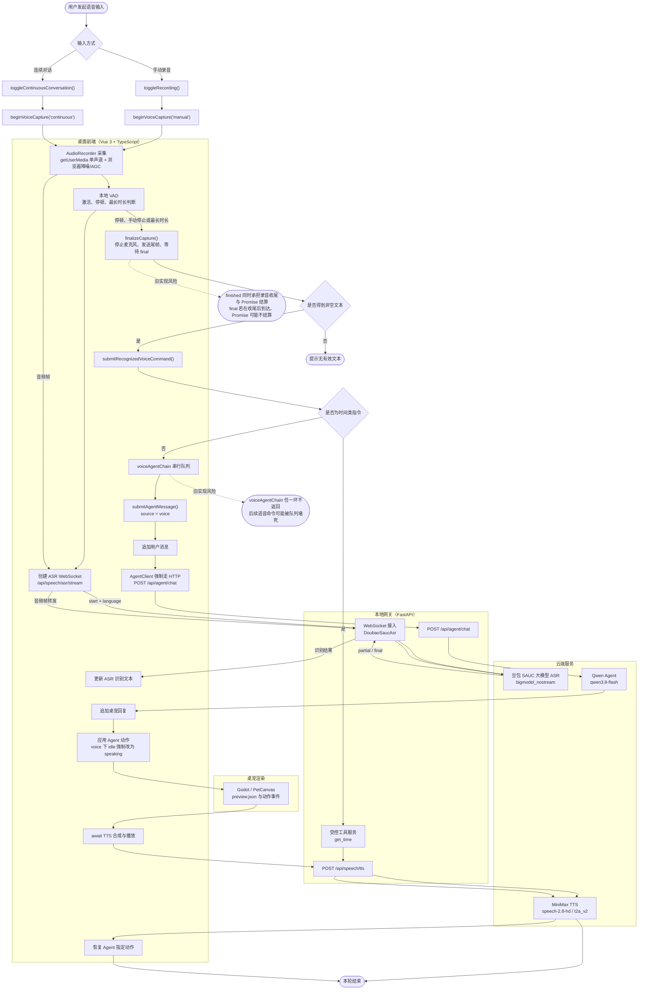
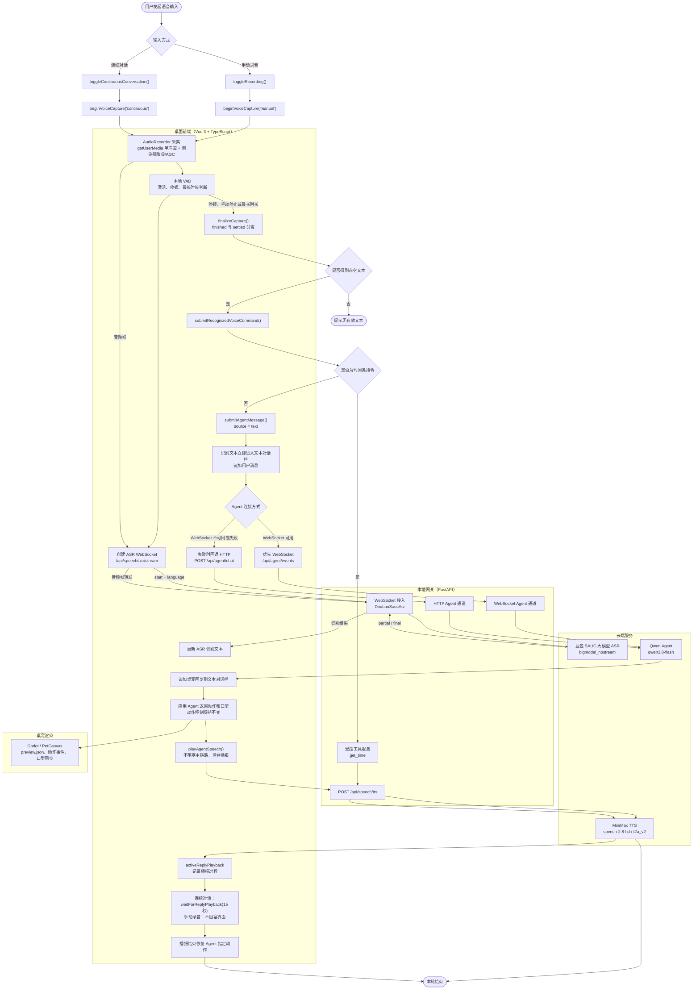

# 语音识别链路与技术栈整理

- **项目版本：** v0.4.0
- **整理日期：** 2026-09-22
- **范围：** 对比“ASR final 复用文本对话链路”改动前后的功能实现流程，并整理当前项目技术栈。

---

## 1. 改动前：独立语音链路

---

## 2. 改动后：ASR final 复用文本对话链路

### 2.1 改动前后关键差异

| 对比项 | 改动前 | 改动后 |
|---|---|---|
| ASR 后续入口 | 独立语音分支，`source = voice` | 复用文本对话分支，`source = text` |
| Agent 通信方式 | 语音请求强制走 HTTP | 优先 WebSocket，失败回退 HTTP |
| TTS 时机 | 在 `submitAgentMessage()` 中等待播放完成 | 文本回复与动作落地后后台播放 |
| 连续对话 | 依赖整条语音函数返回 | 显式等待 `activeReplyPlayback`，带 15 秒超时 |
| Promise 状态 | `finished` 同时表示收尾和结算 | `finished` 与 `settled` 分离 |
| 串行控制 | `voiceAgentChain` 队列 | 移除队列，使用现有 `agentState` 状态守卫 |
| 动作控制 | listening / thinking / Agent 动作 | 保持原有逻辑，TTS 后恢复 Agent 指定动作 |

---

## 3. 当前技术栈整理

| 层级 | 技术 / 服务 | 当前版本 / 模型 | 用途与状态 |
|---|---|---|---|
| 目标平台 | Windows | Windows 10/11 x64 | 桌面桌宠主运行平台 |
| 前端框架 | Vue | 3.5.20 | 主控制台、文本对话、语音调试、资源调试 |
| 前端语言 | TypeScript | 5.9.2 | 前端类型安全与业务逻辑 |
| 构建工具 | Vite | 7.1.3 | 前端开发服务器与生产构建 |
| Vue 类型检查 | vue-tsc | 3.0.6 | `.vue` 与 TypeScript 类型检查 |
| 桌面容器 | Tauri | 2（CLI 2.11.4，API 2.11.1） | 桌面窗口、应用生命周期、进程管理、资源打包 |
| 桌面后端语言 | Rust | 1.98.0，edition 2021 | Tauri 主程序、网关/Godot 进程托管 |
| Rust 依赖 | tauri、serde、serde_json、base64、tauri-build | tauri 2、serde 1、base64 0.22 | 桌面命令、状态序列化、Token/资源处理 |
| 本地网关 | FastAPI | 0.141.1 | REST 与 WebSocket API |
| ASGI 服务 | Uvicorn | 0.52.4 | 本地 FastAPI 网关运行时 |
| 数据校验 | Pydantic | 2.13.5 | 请求/响应模型、配置校验 |
| HTTP 客户端 | httpx | 0.28.1 | 云端 Agent、TTS、RTC OpenAPI 调用 |
| 异步 HTTP | aiohttp | 3.14.3 | 豆包 SAUC WebSocket / 语音服务接入 |
| WebSocket | websockets | 15.0.1 | 实时协议与 Agent/语音事件通道 |
| 环境配置 | python-dotenv | 1.2.3 | `.env` 配置加载 |
| 表单处理 | python-multipart | 0.0.32 | 文件上传与 multipart 表单 |
| ASR | 豆包 SAUC 大模型 | `bigmodel_nostream`，资源 `volc.bigasr.sauc.duration` | 中/日/英文实时语音转写，已接入 |
| TTS | MiniMax | `speech-2.8-hd`，接口 `/t2a_v2` | 多语言、多音色语音合成，已接入 |
| 文本 Agent | Qwen | `qwen3.8-flash` | 文本理解、角色回复、工具调用决策，已接入 |
| 麦克风采集 | MediaDevices / Web Audio | getUserMedia、AudioContext、ScriptProcessor | 单声道采集、浏览器回声消除、降噪、自动增益 |
| 本地断句 | VAD | 自研 TypeScript 逻辑 | 人声激活、停顿断句、最长单句限制 |
| 唤醒词 | WakeWordGate | 本地规则匹配 | 连续对话时支持“小赤红”门控 |
| 口型同步 | Web Audio AnalyserNode / AudioLipSyncPlayer | fftSize 256 | 根据音频能量驱动 closed / half-open / open |
| 音频兜底 | HTMLAudioElement | 浏览器原生 Audio | WebAudio 解码失败时保证可播放 |
| 桌宠渲染 | Godot | 4.7.2 stable | 透明桌宠、SpriteSheet、动作状态机 |
| 桌宠脚本 | GDScript | Godot 4.x | PetController、事件桥、资源包加载 |
| 前端渲染兜底 | Vue PetCanvas | 当前项目组件 | Godot 不可用时的桌宠预览 |
| 动作协议 | preview.json / Pet Event | WebSocket + 本地状态 | listening、thinking、speaking、idle 等动作同步 |
| 本地数据库 | SQLite | Python 标准库 sqlite3 | 记忆、工具审批、本地状态、运行记录 |
| 前端轻量存储 | localStorage | 浏览器内置 | 调试历史、连续对话开关、轻量 UI 状态 |
| RAG 文档服务 | 自研 RAG Service | FastAPI + SQLite/本地哈希向量 | 文档上传、切分、检索、集合管理 |
| Embedding | local-hash-v1 | 本地哈希向量 | 默认本地、无外部 Embedding 依赖 |
| 向量数据库客户端 | PyMilvus | 2.6.17 | 可选 Milvus 接入 |
| 向量数据库 | Milvus | 2.5.14，Docker Compose | 可选向量检索服务，不是默认启动必需项 |
| RTC 官方 SDK | @volcengine/rtc | 4.69.2 | RTC 入房、麦克风发布，声纹链路联调用 |
| RTC 服务 | 火山引擎 VoiceChat / VoicePrint / RTS | API version 2025-06-01 | 主人声纹验证，仍处于云端联调与最终实测阶段 |
| 网关打包 | PyInstaller | 6.22.2 | 将 FastAPI 网关打包为 onedir 运行时 |
| 安装包 | WiX / MSI | Tauri 内置 bundler | 生成 Windows per-machine MSI |
| 前端测试 | Vitest | 3.2.4 | 34 个测试文件、120 个测试通过 |
| 后端测试 | Pytest + pytest-asyncio | 8.4.2 / 0.26.0 | 当前基线为 143 个后端测试通过 |
| 容器环境 | Docker / Docker Compose | 29.4.3 / v5.1.3 | 运行可选 Milvus 服务 |
| 脚本工具 | PowerShell | Windows PowerShell | 构建、修复、环境检查脚本 |
| 版本管理 | Git | 系统可用 | 代码版本管理 |

### 3.1 技术边界说明

1. **ASR、TTS、Qwen Agent 已进入可用/实测阶段**，文本对话与语音转文本链路已打通。
2. **RTC 主人声纹验证不能表述为完全闭环**，目前仍需完成官方 SDK 入房与 RTS 主人回调的最终实测。
3. **Milvus 是增强型可选依赖**，当前默认版本不要求用户必须启动 Docker；本地 SQLite 与本地哈希向量可承担基础调试能力。
4. numpy、pandas、Pillow、lxml 等在 Python 环境/PyInstaller 依赖分析中存在，但当前业务代码没有直接调用，因此不作为核心业务技术栈展开。
